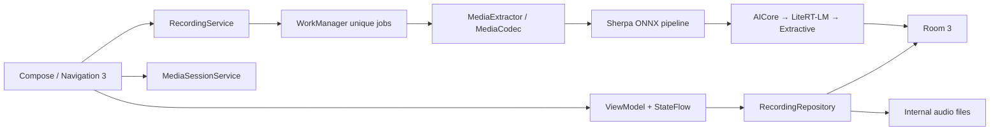

# StayWord Android

StayWord 的 Android 原生版本。项目以 iOS 生产代码为功能基线，使用 Jetpack Compose 和 Android
系统能力重新实现交互，不修改或依赖 iOS 工程。

## 已实现功能

- 资料库：首页、全部录音、收藏、用户文件夹、最近删除、恢复与永久删除。
- 文件管理：标题编辑、搜索、长按多选、滑动操作、移动文件夹、文件夹排序，以及通过系统
  Storage Access Framework 导入单个音频。
- 录音：`MediaRecorder` 录制 MPEG-4/AAC（44.1kHz、单声道、96kbps），前台服务持有会话，
  支持暂停、继续、停止、通知计时与通知操作。Activity 重建或应用进入后台不会终止录音。
- 播放：Media3 `MediaSessionService` + ExoPlayer，支持后台播放、系统媒体面板、锁屏/蓝牙控制、
  精确跳转和前后 15 秒。
- 离线转写：16kHz 单声道 PCM → Silero VAD → Pyannote + 3D-Speaker 说话人分离 →
  SenseVoice 多语言转写；参数和 28 秒切段规则与 iOS 生产实现保持一致。
- 离线摘要：前台且 AICore Prompt API 已可用时优先 Gemini Nano；否则使用内置
  Qwen3-0.6B INT4 + LiteRT-LM；初始化失败或内存不足时使用确定性抽取式摘要。
- 系统集成：粗略位置标题建议、动态色/深色模式、预测返回、中英文资源、静态 Launcher
  Shortcuts，以及 `stayword://recording`、`stayword://recent` 深链。
- 隐私：不声明 `INTERNET`，数据库、录音、转写和摘要均保存在应用凭据保护的内部存储；
  Auto Backup 和设备迁移备份均关闭。

未扩展 iOS 尚未完成的分享和录音标记入口；数据库仍保留标记结构并可在详情页展示已有标记。

## 架构



应用使用单 Activity、Application 级手动依赖容器和单向数据流。所有处理任务追加到同一个
WorkManager 唯一链，保证重型模型严格串行加载；任务与处理阶段同时持久化，应用重启后会恢复
未完成任务。删除录音通过 Room 中的回收站状态让对应节点在下一个阶段边界安全退出；节点仍以成功
状态结束，因此不会级联取消队列中的其他录音。

核心代码位置：

- `app/src/main/java/com/rivendell/stayword/data`：Room、文件存储和 Repository。
- `app/src/main/java/com/rivendell/stayword/media`：录音、播放和位置系统能力。
- `app/src/main/java/com/rivendell/stayword/processing`：音频准备、模型安装、转写、摘要和任务队列。
- `app/src/main/java/com/rivendell/stayword/ui`：Compose 页面、Navigation 3 和 ViewModel。

## 离线模型

运行时模型通过 Git LFS 跟踪，完整文件约 599MB。`app/src/main/assets/models/manifest.json` 固定了
每个文件的版本、大小、SHA-256、来源和许可证。`verifyModelAssets` 会验证所有运行时资产，而应用
首次启动时会再次校验并原子复制到 `noBackupFilesDir/models`。空间不足或复制失败不会阻止录音和
资料库使用。

模型来源和许可证说明见 `app/src/main/assets/models/NOTICE.md`。SenseVoice 权重遵循上游
FunASR Model License；Pyannote 与 Silero 为 MIT；3D-Speaker、Qwen3 和 sherpa-onnx 为
Apache-2.0。

当前 sherpa-onnx 1.13.2 Android Kotlin API 未公开其 C 层流式 resampler，因此
`MediaCodecAudioPcmPreparer` 在解码后使用等价的单声道线性重采样实现；VAD、说话人分离与识别
本身均直接使用 sherpa-onnx Android runtime。

## 构建

要求：Android Studio、JDK 17+、Android SDK Platform 36.1，以及 Git LFS。仓库固定使用：

- AGP 9.3.0 / Gradle 9.5.0 / Kotlin 2.3.21
- `compileSdk 36.1` / `targetSdk 36` / `minSdk 31`
- Compose BOM 2026.06.00、Material 3 1.4.0、Navigation 3 1.1.4
- Room 3.0.0、Media3 1.10.1、WorkManager 2.11.2
- sherpa-onnx 1.13.2、LiteRT-LM 0.13.1

```bash
git lfs pull
./gradlew verifyModelAssets lintDebug testDebugUnitTest assembleDebug
```

Release 仅打包 `arm64-v8a`：

```bash
./gradlew assembleRelease
```

Android Studio 自带 JBR 21 也可执行构建；源码与字节码目标仍固定为 Java 17。

## 测试

- JVM 单元测试覆盖时间格式、名称校验、搜索转义、分段合并/28 秒拆分、说话人编号、摘要去重与
  模型 manifest。
- 仪器测试覆盖 Room 搜索、文件夹/回收站关系，以及首页、搜索和详情 Tab 的 Compose 行为。
- 有连接设备时执行：

```bash
./gradlew connectedDebugAndroidTest
```

真实离线推理需在 ARM64 设备验收，重点覆盖 Android 12 与 Android 16.1、后台录音、输入路由中断、
锁屏播放、中文/英文/多人录音，以及 m4a/mp3/wav 导入。

## 权限

- `RECORD_AUDIO`：开始录音时解释并请求。
- `POST_NOTIFICATIONS`：Android 13+ 与麦克风权限一起请求；拒绝不影响保存录音。
- `ACCESS_COARSE_LOCATION`：录音开始后单独解释并请求，仅用于可选标题建议。
- 前台服务权限仅用于麦克风录音、媒体播放和本机媒体处理。

项目没有账号、云同步、云端 AI、统计上报、iOS 数据迁移或 Play 发布结构。
