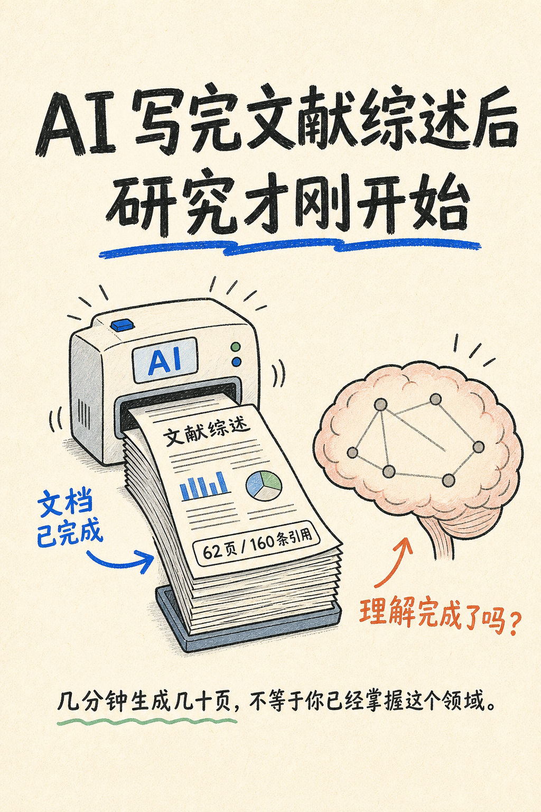
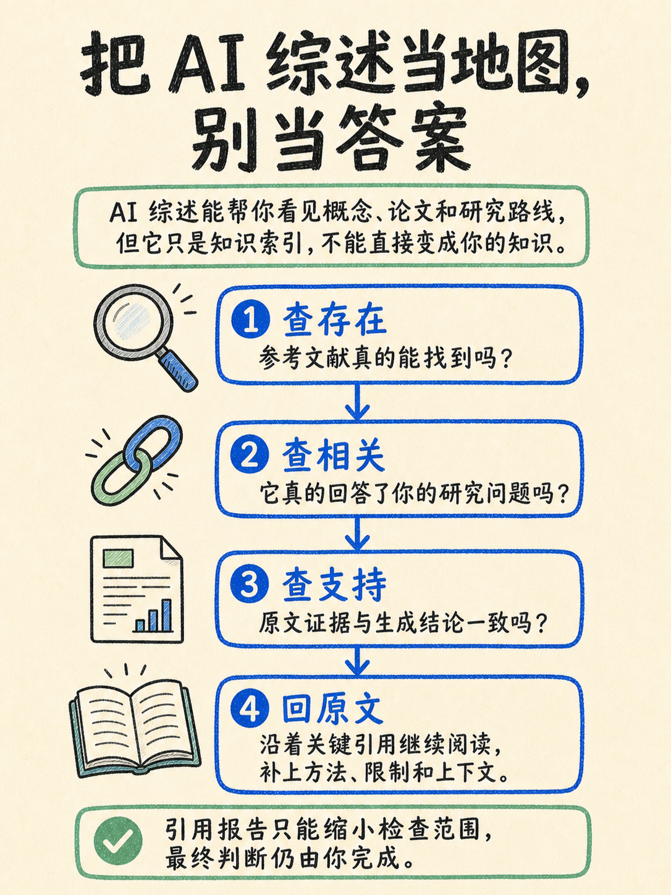
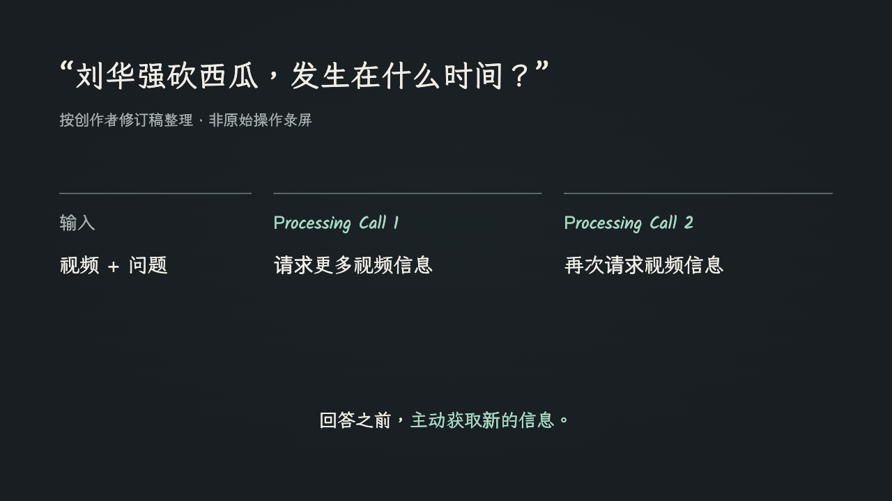

# 内容生产 Agent 与 Skill 工作流

**把个人内容创作中反复发生的任务，做成可组合、可修改、可检查的 AI 工作流。** 从视频改编、口播素材制作，到产品内容与选题研究，交付能继续编辑和使用的具体产物。

李适独立完成需求梳理、流程设计、实现与迭代。项目面向本人创作，已留下图文、演示、封面、产品草稿和选题报告，以及相应的修改与运行记录。

[产品案例与方案取舍](docs/case-study.md) · [验证结果](evaluation/release-review.md) · [实现入口](#实现与运行)

## 为什么做

一次生成往往不是任务的终点。真实创作中，八张卡片会改成六张，已有实机演示时只需要文案和封面，手动修改文案后图片要跟着调整；程序也可能已经保存草稿，却在发布准备阶段失败。

我将产品目标定为：**一次任务交付什么先说清，修改时能找到关联材料，完成后知道哪些能用、哪些还需处理。** 因此按产物拆分能力，保留分析、规划与文案等中间材料，并将内容判断和执行状态分开。

四个板块覆盖同一位创作者的不同任务：找选题、改编外部素材、制作口播配套素材、解释自己的产品。任务可以分别发生，所以各有入口，当前不强制串成自动流水线。

| 板块 | 输入 → 交付 | 关键产品选择 |
| --- | --- | --- |
| content-workflow | 视频 → 分析、正文、系列卡片 | 共享理解，正文与图片分别组织 |
| script-workflow | 口播稿 → 演示、文案、三比例封面 | 三个 Skill 按需调用，修改沿产物依赖传递 |
| content-agent | 产品与账号资料 → 研究、审改、候选稿 | 有限审改，事实、模型评分和采纳分别判断 |
| daily-trend-radar | 公开榜单 → 来源报告、候选选题 | 采集与解读分离，保留来源、时间和失败状态 |

## 四类实际交付

### content-workflow · 同一视频，两种阅读方式

**任务：** 将一条文献综述主题视频改编成中文图文。本人在规划阶段提出“八张有点多了，6 张吧”，并要求只看图片也能理解。

正文和卡片从同一份分析出发，各自组织阅读顺序。“八张改六张”对应两次信息合并：将“效率冲击＋综述目的”合成一页，将“提问反驳＋貌似可信的风险”合成一页，保留核查、重构与行动建议。页数减少，读者需要的解释仍保留在图里。

这个案例体现了一个交付原则：图片要独立完成解释，而不只是给正文配一张摘要。下面是历史生成的封面与一张解释内页。

  
  

**交付：** 一篇完整正文和六张生成卡片，保留从输入到两版规划的修改过程。历史最终裁切文件缺失，当前展示原图；其中 62 页、160 条是来源视频中的案例数字。

[阅读完整正文](demo/content-workflow/2026-08-27-literature-review/result/post.md) · [六张图片与修改记录](demo/content-workflow/2026-08-27-literature-review/README.md) · [产品设计](docs/content-workflow.md)

### script-workflow · 允许部分执行，也要处理版本变化

**任务：** 将同一期口播稿制作成 HTML 演示、发布文案与三比例封面。另一条真实任务已有实机演示，明确只做文案与封面，验证了单项调用的必要性。

三个 Skill 分别交付演示、文案和封面。演示与文案读取原稿，封面承接已编辑的本期文案；已有实机演示时可直接跳过演示制作。

灵活调用也带来版本问题：第 005 期演示第 5–7 页仍沿用旧稿。本轮按修订稿对齐页面，并增加交接检查，提醒关联文件发生了变化；具体内容仍按原稿核对。

*真实 HTML 的浏览器截图；图中两次调用来自历史口播稿，本轮未重跑视频识别实验。*

**交付：** 可按口播顺序播放的 15 页演示、发布文案和三比例封面。已检查 42 个播放状态；部分执行任务还保留了“跳过演示 → 手动改文案 → 调整封面”的实际过程。

[修订前后与播放截图](demo/script-workflow/2026-10-16-version-alignment/README.md) · [文案与三封面](demo/script-workflow/2026-09-26-agentic-video/artifacts/post/005/) · [部分执行记录](demo/script-workflow/2026-09-25-partial-task/README.md) · [产品设计](docs/script-workflow.md)

### content-agent · 模型通过后，仍要回到产品事实

**任务：** 根据 BirdTracker 的产品与账号资料，研究、写作并审改产品内容。历史稿在两轮审稿中从 8.4 到 8.6，通过内部规则后保存，但发布准备失败。

本轮依据产品资料重新审核 9 项主张，5 项有支持，4 项需删除或调整。下表展示其中两项判断及修订后的表达。

| 原稿问题 | 复核处理 |
| --- | --- |
| 暗示使用热点即可找到鸟多的地方 | 改为“热点提供地点线索，实际鸟况仍需现场观察” |
| 标题暗示一次亲历观鸟 | 改为“把散步时看到的鸟，留在自己的观察记录里” |

**交付与判断：** 形成有产品资料依据的修订候选稿。这个结果使验收必须分成两层：程序判定审稿是否通过，创作者再判断事实与表达能否采用。提高模型分数不能代替事实核对。

保存计数异常也已修复：发布准备失败时仍保留“草稿已保存”的状态，避免把已完成的写作判成全部失败。事实复核为本轮 AI 辅助审校；候选稿尚未记录本人最终采纳。

[完整候选稿](demo/content-agent/2026-10-16-draft-review/post.txt) · [九项事实审校](demo/content-agent/2026-10-16-draft-review/README.md) · [历史运行](demo/content-agent/2026-07-09-birdtracker/README.md) · [产品设计](docs/content-agent.md)

### daily-trend-radar · 给出选题依据，也说明信息缺失

**任务：** 为 AI 与科技内容准备选题。程序采集公开榜单并保留链接与来源状态，Agent 根据受众关联和验证成本筛选角度。

| 2026-10-16 实际采集 | 条目数 | 发布时间情况 |
| --- | --- | --- |
| GitHub Trending | 5 | 缺失，按当前在榜保留 |
| Hacker News | 5 | 缺失，按当前在榜保留 |
| V2EX | 5 | 保留来源提供的发布时间 |

**交付与判断：** 一份三源 15 条的报告和三个候选选题。选择“装了 Skill，为什么还需要插件目录”作为优先建议，因为它与目标读者相关，也能用已有工作流解释；另一个上下文工具主题仍需安装和对照，暂不直接做教程。筛选同时考虑读者价值与验证投入。

本次经历两次直接请求超时，沿用系统代理后恢复。三条建议均来自 GitHub，不代表跨平台共振。

全源失败时现在也会保存诊断，方便定位缺失。一次采集验证了本次交付，长期可用性仍需持续观察。

[阅读选题简报](demo/daily-trend-radar/2026-10-16-source-check/brief.md) · [原始报告与失败恢复](demo/daily-trend-radar/2026-10-16-source-check/README.md) · [产品设计](docs/daily-trend-radar.md)

## 我如何确定方案与下一步

| 产品问题 | 当前选择 | 保留的代价 |
| --- | --- | --- |
| 为什么不每次直接问模型？ | 将反复使用的事实、表达要求与交付规则固化，单次只传本期输入与变更 | 规则需要维护；临时、简单任务仍可直接对话 |
| 哪些交给 AI，哪些写成程序？ | 理解、改编、叙事与选题使用模型；编号、尺寸、状态和停止条件由程序处理 | 模型输出仍需复核，程序也不能判断所有内容质量 |
| 自动化推进到哪里？ | 先保证产物可编辑、变更可接续、失败可解释 | 保留人工选择与验收，跨板块自动调度暂未投入 |

当前优先处理事实错误和版本错配：它们会让结果无法采用。其次记录视觉返工和人工修正；只有交付质量稳定后，才有依据讨论减少多少操作时间、是否值得自动串联。

项目现有证据最充分的是 **AI 工作流设计、任务与上下文组织、质量判断和问题迭代**。面向更多用户的需求验证、采纳率、费用与增长效果仍缺少数据；这些是产品下一阶段的验证任务。完整推导见[产品案例](docs/case-study.md)。

## 实现与运行

| 板块 | 实现入口 | 验收依据 |
| --- | --- | --- |
| content-workflow | [三个 Skill 与字幕工具](src/content-workflow/README.md) | [内容与规格核查](evaluation/content-workflow/README.md) |
| script-workflow | [三个 Skill 与交接检查](src/script-workflow/README.md) | [播放、封面与版本核查](evaluation/script-workflow/README.md) |
| content-agent | [Python 程序](src/content-agent/README.md) | [草稿与保存状态核查](evaluation/content-agent/README.md) |
| daily-trend-radar | [Skill 与 Node 工具](src/daily-trend-radar/README.md) | [采集、时间与异常核查](evaluation/daily-trend-radar/README.md) |

相关实现的 29 项回归测试覆盖特定工程行为，不等于内容质量或业务效果。模型推理、图像生成和工具执行由宿主或外部服务提供；来源版本与作品集修订见[来源核对](../../SOURCE_CHECK.md)。

本地交互演示与运行说明

本页与[文字案例](docs/case-study.md)可直接在 GitHub 阅读。克隆仓库后打开 `demo/index.html`，可查看图片放大、素材切换及内嵌演示；需保留相对路径引用的素材。[本地 HTML 文件](demo/index.html)是补充体验入口。

运行各板块时使用上表对应说明。内容 Agent 仅生成草稿时使用 `--no-publish`；`--publish-dry-run` 仍会操作发布页。雷达本轮只生成本地报告，未发送邮件；后续如需邮件交付，唯一允许收件人为本人 doublegou@gmail.com。

[使用记录依据](docs/evidence-notes.md) · [工程结构说明](docs/architecture.md)

