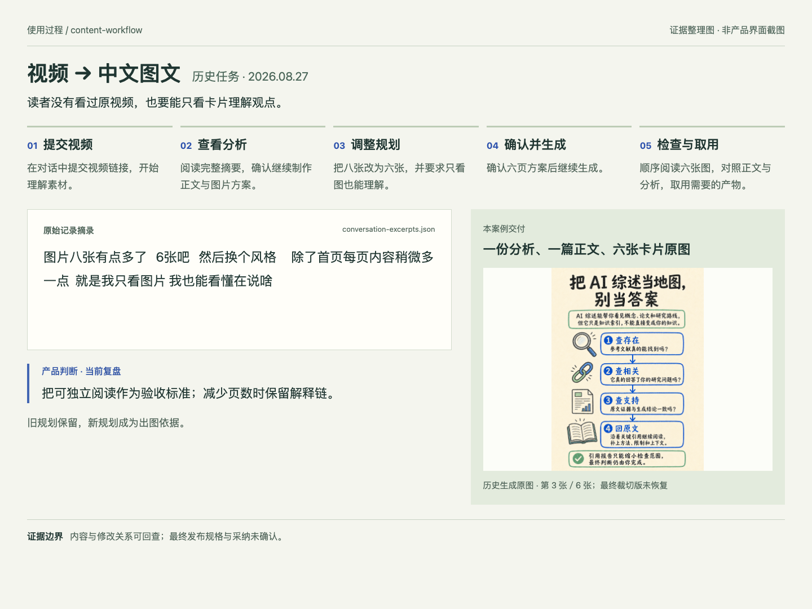
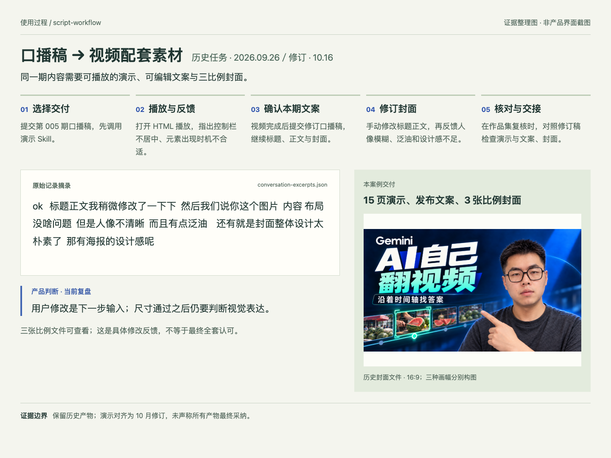
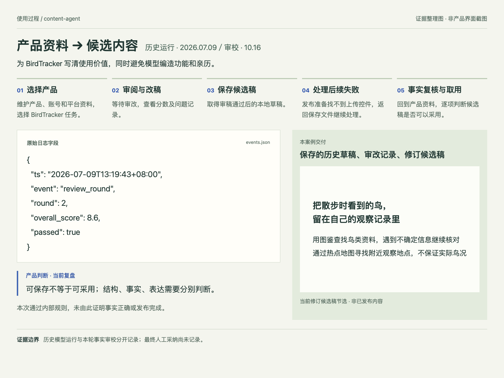
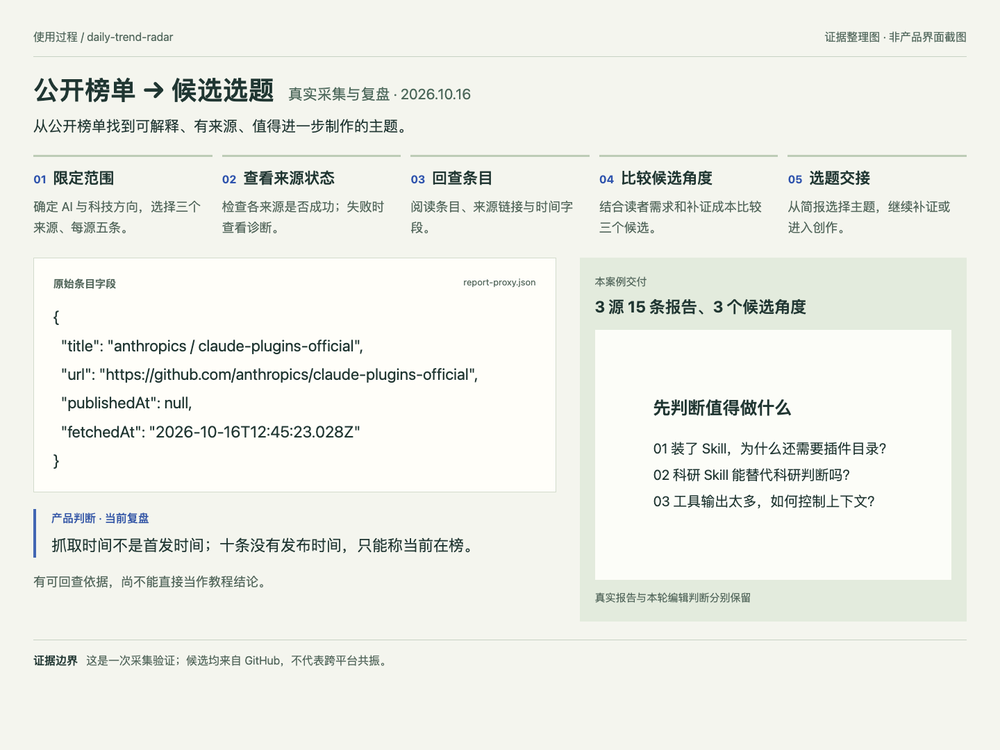

# 内容生产 Agent 与 Skill 工作流

**把“生成一段内容”，推进到“交付一次创作任务”。**

面向独立科技内容创作者的个人实践项目。围绕选题研究、视频改编、口播配套素材和产品内容四类需求，设计并实现可组合的 AI 工作流，保留输入、修改、产物与验证依据。需求梳理、产品设计、实现和迭代均独立完成。

[产品设计与方案取舍](docs/case-study.md) · [四类任务的使用过程](#四类任务的端到端案例) · [实现入口](#实现与验证)

## 用户为什么需要它

创作者真正要完成的是一期内容：找到值得讲的主题，把资料变成读者能理解的表达，再拿到可编辑、可播放或可用于发布准备的素材。直接对话可以完成一次生成，但重复任务仍要重新说明要求，修改之后还要找到哪些产物需要一起更新。

真实使用记录暴露了三个问题：要求会在过程中变化；任务可能只需要整套产物的一部分；“生成成功”与“用户拿到可用成果”并不是同一件事。

| 已发生的用户行为 | 需要解决的产品问题 | 当前设计 |
| --- | --- | --- |
| 要求八张卡片改为六张，且只看图就能理解 | 结构要能在出图前调整，不能只减少图片数量 | 分析、正文、图片规划分开保存 |
| 已有实机演示，只需要文案与封面；之后手动改标题 | 流程要承接已有工作，修改要传递到相关素材 | 三个 Skill 按需调用，以本期文件交接 |
| 草稿保存后发布准备失败，日志却将保存计为零 | 一个失败状态掩盖了已经交付的部分 | 分开记录保存与发布结果，并修复计数 |

目标不是让每一步都自动运行，而是让创作者知道：**从哪里开始、可以在哪里改、这次交付了什么、还差什么。** 目前直接用户为本人，未将个人需求推断为市场普遍需求。

## 产品怎样使用

使用入口是 **Codex 对话中的 Skill，以及本地 Python / Node 程序**。这是一套围绕同一创作活动组织的工作流；四个板块各有入口，尚未实现统一应用或自动调度。

| 此刻手里有什么 | 使用哪个板块 | 用户最终拿到什么 |
| --- | --- | --- |
| 一条想改编的视频 | **content-workflow**：yt-analysis → note-writer / note-images | 分析、中文正文、系列图片 |
| 已经写好的口播稿 | **script-workflow**：script-to-html-slides / script-to-post / script-to-image | 演示、发布文案、三比例封面；可只做其中一部分 |
| 产品资料与账号表达规则 | **content-agent**：研究 → 写作 → 有限审改 → 保存 | 有审改记录、可继续复核的候选稿 |
| 待研究的方向与来源范围 | **daily-trend-radar**：采集 → 回查 → 筛选 | 有来源与不确定项的报告、候选选题 |

**确定交付范围 → 提供素材 → AI 理解与创作 → 查看并修改 → 验收取用**

这是四类任务共同的交互原则，不表示它们已自动串成一条流水线。下面每个案例都沿同样的顺序展开：**任务 → 使用过程 → 关键选择 → 交付与验证**。

## 四类任务的端到端案例

### 01 · content-workflow：从一条视频到能独立阅读的图文

**任务与完成标准。** 将文献综述主题视频改编为中文图文。读者可以不看原视频，也不看正文，仅靠卡片理解中心观点与行动建议。

逐步查看用户操作与系统响应

| 步骤 | 用户如何操作 | 系统交付 / 用户下一步 |
| --- | --- | --- |
| ① 提交素材 | 在对话中发送视频链接 | 得到分析、摘要与二创形式建议 |
| ② 选择继续 | 阅读分析后要求制作图文 | 得到完整正文与八页图片规划 |
| ③ 调整结构 | 要求改为六张、换风格、增加内页解释 | 重组规划，保留旧版供对照 |
| ④ 确认出图 | 确认六页规划 | 生成六张图片与对应提示词，正文单独保留 |
| ⑤ 检查取用 | 顺序看图，再核对正文、来源和规格 | 取用正文与图片；本案例最终裁切版缺失，不能认定全套发布就绪 |

*历史证据整理图：上方为完整旅程，左侧为原始反馈与当前复盘，右侧为真实产物；不是 Codex 原界面截图。四个案例统一使用这一版式。*

**关键选择。** 正文与卡片共享分析，各自组织表达。八张改六张时，将“效率冲击＋综述目的”和“提问反驳＋貌似可信的风险”分别合并，保留核查、重构与行动建议。这样调整的是信息组织，而不只是出图数量。共享分析也意味着分析错误可能影响两个分支，必须先核对依据。

**交付与验证。** 一篇正文、六张生成原图、两版规划和修改记录。核心内容有对应；原图比例不统一，历史最终裁切文件未恢复。图中的 62 页、160 条是视频里的案例数字，不是本工作流的效果指标。

[完整案例与六图](demo/content-workflow/2026-08-27-literature-review/README.md) · [阅读正文](demo/content-workflow/2026-08-27-literature-review/result/post.md) · [产品设计](docs/content-workflow.md)

### 02 · script-workflow：从口播稿到同一期视频配套素材

**任务与完成标准。** 为第 005 期讲解视频制作可跟随口播播放的演示、可编辑文案与三比例封面。讲述顺序、标题承诺和图片主题要一致；已有素材时可以跳过对应环节。

逐步查看用户操作与系统响应

| 步骤 | 用户如何操作 | 系统交付 / 用户下一步 |
| --- | --- | --- |
| ① 选择范围 | 提交口播稿，先要求制作演示 | 得到按口播顺序组织的 HTML |
| ② 实际播放 | 打开 HTML，逐步播放，反馈居中与出现时机 | 调整控制栏、分步揭示，继续用于录制 |
| ③ 继续素材 | 视频完成后提供本期修订稿 | 生成标题、正文，再制作三种画幅封面 |
| ④ 局部修改 | 手动改文案，反馈人像模糊、泛油和设计感不足 | 保留新文案，更新封面 |
| ⑤ 核对交接 | 对照原稿检查演示及发布素材 | 作品集复核发现版本漂移，修订第 5–7 页并记录文件关联 |

*历史证据整理图。演示版本对齐发生在 2026-10-16，未把后来的修订写成 9 月任务已完成的行为。*

**关键选择。** 三个 Skill 各自交付明确产物，封面承接已编辑文案。同一时期的另一个真实任务已有实机演示，明确只做文案与封面，说明“部分执行”应作为正常路径。代价是需要处理多文件依赖，文件指纹只能提醒变更，不能代替语义核对。

**交付与验证。** 修订后 15 页演示、42 个播放状态，发布文案与三张比例封面。历史记录中有播放和视觉修改反馈；没有把这些反馈扩写为全套最终采纳。两次 Processing Call 与视频时间回答来自口播稿，演示不冒充本轮视频识别实验。

[完整历史任务与素材](demo/script-workflow/2026-09-26-agentic-video/README.md) · [真实 HTML 播放截图与修订](demo/script-workflow/2026-10-16-version-alignment/README.md) · [部分执行案例](demo/script-workflow/2026-09-25-partial-task/README.md) · [产品设计](docs/script-workflow.md)

### 03 · content-agent：从产品资料到可复核的候选稿

**任务与完成标准。** 为 BirdTracker 写清使用价值。草稿必须结构完整、表达受产品资料支持，不能编造个人经历或把地点线索写成效果保证。

逐步查看用户操作与系统响应

| 步骤 | 用户如何操作 | 系统交付 / 用户下一步 |
| --- | --- | --- |
| ① 准备上下文 | 维护产品、账号与平台资料，选择产品 | 读取资料，研究选题，组织初稿 |
| ② 查看审改 | 查看审稿问题与轮次 | 由 reviewer 评估、editor 修改，最多五轮 |
| ③ 取得候选 | 本次第二轮通过内部规则 | 保存可编辑 JSON 草稿 |
| ④ 处理失败 | 发布准备失败时回到已保存草稿 | 独立保留内容结果与发布异常 |
| ⑤ 事实复核 | 对照资料逐项核查，再决定是否采用 | 本轮删改无依据表达，形成修订候选稿 |

*历史日志摘录与本轮修订产物并列展示。原始运行开启发布演练；本轮整理未运行发布。仅生成草稿的入口使用 `--no-publish`。*

**关键选择。** 模型处理研究、表达与审改，程序控制结构与停止条件。历史这次运行从 8.4 到 8.6 通过，但本轮九项主张中仍有四项需要删除或调整：模型通过不能替代事实复核。保存计数错误已修复，发布准备失败不会再掩盖已保存的草稿。

**交付与验证。** 原始草稿与两轮审改日志、九项主张复核、修订候选稿。四项问题包括不支持的功能关联与亲历暗示；修订结果尚未记录最终人工采纳。当前没有强制人工批准的统一发布入口，不能据此宣称实现无人值守可靠发布。

[历史运行与异常](demo/content-agent/2026-07-09-birdtracker/README.md) · [九项复核与修订稿](demo/content-agent/2026-10-16-draft-review/README.md) · [阅读候选正文](demo/content-agent/2026-10-16-draft-review/post.txt) · [产品设计](docs/content-agent.md)

### 04 · daily-trend-radar：从公开榜单到值得继续研究的选题

**任务与完成标准。** 为 AI 与科技内容寻找主题。候选要说明与读者的关系、有原始依据，并明确哪些事实还需验证；不能只给一串热榜标题。

逐步查看用户操作与系统响应

| 步骤 | 用户如何操作 | 系统交付 / 用户下一步 |
| --- | --- | --- |
| ① 限定范围 | 选择 GitHub、Hacker News、V2EX，每源五条 | 执行采集，保留本次范围 |
| ② 检查状态 | 查看成功来源和失败原因 | 直接请求失败后，用已有代理恢复；诊断仍保留 |
| ③ 回查条目 | 阅读标题、原始链接与时间字段 | 区分抓取时间和发布时间；缺失项保持未知 |
| ④ 筛选角度 | 比较受众关联、证据和进一步验证成本 | 形成三个候选，分别列事实、推断和待验证项 |
| ⑤ 决定后续 | 选择继续研究的主题，再进入创作 | 交付报告与简报；本案例未自动触发内容制作或邮件 |

*真实采集记录的整理图。报告与编辑判断分开保存；画面不是已实现的雷达仪表盘。*

**关键选择。** 采集负责线索与状态，Agent 解释角度，创作者决定是否继续。优先建议“装了 Skill，为什么还需要插件目录”，因为可用已有实践解释；需要安装对照的上下文工具主题暂缓做教程。筛选同时考虑读者价值与验证投入。

**交付与验证。** 2026-10-16 三源 15 条报告、三个候选角度。十条缺少发布时间，仅表述为当前在榜。三个候选均来自 GitHub，不称跨平台共振；一次采集也不足以证明长期稳定或选题有效。

[完整报告与恢复过程](demo/daily-trend-radar/2026-10-16-source-check/README.md) · [阅读选题简报](demo/daily-trend-radar/2026-10-16-source-check/brief.md) · [产品设计](docs/daily-trend-radar.md)

## 从这些案例得到的产品判断

| 决策 | 为什么这样做 | 代价与下一步检验 |
| --- | --- | --- |
| 可变化的表达交给模型，稳定规则交给程序 | 叙事与选题需要语义判断；尺寸、编号、状态和停止条件需要一致性 | 确定性检查不能代替事实与视觉验收 |
| 在关键中间结果保留编辑入口 | 用户实际会改范围、稿件和设计，不能只给不可追溯的最终输出 | 确认增加操作；需比较它是否减少后续返工 |
| 以“本次约定的可用交付”判断完成 | 缺少未要求的 PPT 不算失败；保存成功也不等于发布成功 | 需要记录任务范围、质量和采纳，不能只数生成文件 |
| 先完善独立任务，再考虑自动串联 | 主题选择与上下文常常改变，四种任务不一定连续发生 | 保留人工交接；只有候选进入创作的比例足够高才值得增加调度 |

当前证据可展示需求抽象、AI 能力边界、工作流设计、质量评估与问题迭代。尚缺多用户需求验证、连续任务采纳率和完整成本数据。下一轮应先对固定输入比较直接生成与当前工作流，记录主动操作时间、事实修正、视觉返工和合格交付成本，再决定哪些环节值得加强自动化。详见[产品案例中的验证设计](docs/case-study.md#7-下一轮怎样验证这些设计是否值得保留)。

## 实现与验证

| 板块 | 实现入口 | 验证材料 |
| --- | --- | --- |
| content-workflow | [三个 Skill 与字幕工具](src/content-workflow/README.md) | [内容与规格核查](evaluation/content-workflow/README.md) |
| script-workflow | [三个 Skill 与交接检查](src/script-workflow/README.md) | [播放、封面与版本核查](evaluation/script-workflow/README.md) |
| content-agent | [Python 程序](src/content-agent/README.md) | [草稿与保存状态核查](evaluation/content-agent/README.md) |
| daily-trend-radar | [Skill 与 Node 工具](src/daily-trend-radar/README.md) | [采集、时间与异常核查](evaluation/daily-trend-radar/README.md) |

2026-10-16 通过的 29 项相关回归测试验证特定工程行为，不代替内容质量或业务效果。模型推理、图像生成与工具运行依赖宿主或外部服务；[来源核对](../../SOURCE_CHECK.md)区分原始来源与作品集修订。

来源与证据说明

本页直接提供完整阅读路径。四张过程图是依据真实对话、日志和产物整理的说明图，不是产品原界面截图；原始材料及哈希见[来源记录](demo/process-evidence/provenance.json)。现有 HTML 为补充素材，本轮不扩建网页作品集。

[使用记录依据](docs/evidence-notes.md) · [工程结构](docs/architecture.md) · [参考案例与采用方式](docs/case-study.md#8-作品集呈现参考)

雷达邮件约束：仅在明确要求发送时，收件人为本人 doublegou@gmail.com，不添加其他收件人。

