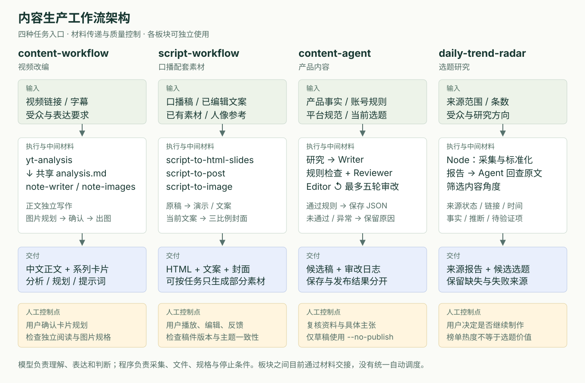
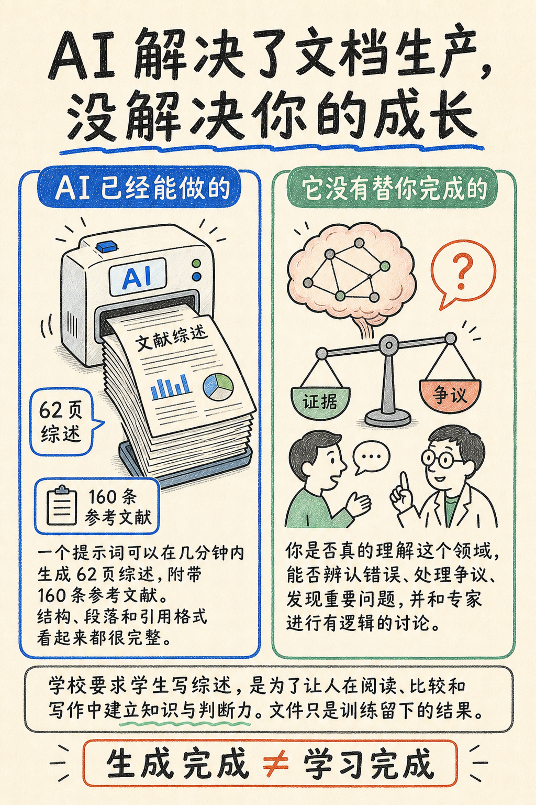
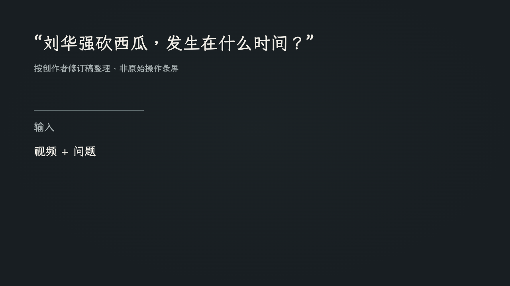

# 内容生产 Agent 与 Skill 工作流

**把一期内容从素材变成可用交付，让创作者能够随时修改、接续和取用。**

我在自己的科技内容创作中设计和迭代这套工作流，覆盖选题研究、视频改编、口播配套素材和产品内容四类任务。已形成正文与系列卡片、可播放演示与三比例封面、产品候选稿、来源报告与选题简报。产品入口是对话 Skill 与本地程序，交付保留为可编辑文件。

我关注的是**一次创作任务能否完成**：生成后还要检查事实、调整表达、同步版本、拿到所需素材。这些工作决定 AI 是否真正减轻制作负担。

[整体架构](#整体架构与任务入口) · [需求与 MVP](#需求规划与-mvp) · [阶段路线图](#从-0-到-1到-10再到-100) · [实际交付](#四类真实交付) · [Quick Start](docs/quick-start.md)

## 整体架构与任务入口



四个模块服务同一位创作者，按**已有材料和本次交付目标**进入。雷达提供研究线索，另外三条路径分别处理外部视频、自己的口播稿和产品资料；它们可独立使用，由我选择和交接材料，目前没有跨模块统一调度器。

| 从什么开始 | 使用路径 | 可直接查看的实际成果 |
| --- | --- | --- |
| 一条值得解释的视频 | **content-workflow**：共享分析 → 正文 / 卡片规划 → 确认出图 | [一篇正文、六张原图与两版规划](demo/content-workflow/2026-08-27-literature-review/README.md) |
| 一期已经写好的口播稿 | **script-workflow**：按需选演示、文案、封面 → 播放 / 编辑 → 核对本期素材 | [第 005 期三类素材](demo/script-workflow/2026-09-26-agentic-video/README.md)；[15 页演示修订](demo/script-workflow/2026-10-16-version-alignment/README.md) |
| 产品事实与账号表达要求 | **content-agent**：研究 → 写作 → 有限审改 → 保存 → 人工取用 | [BirdTracker 原稿、逐项复核与修订候选](demo/content-agent/2026-10-16-draft-review/README.md) |
| 下一期的研究方向 | **daily-trend-radar**：采集 → 回查来源 → 筛选角度 → 决定是否制作 | [三源 15 条记录与三个选题角度](demo/daily-trend-radar/2026-10-16-source-check/README.md) |

## 需求规划与 MVP

**优先用户：已有原始材料、需要反复制作科技或产品内容的独立创作者。** 我从个人任务切入：重复说明要求、修改后素材不一致、生成完成却拿不到合格交付，是首先要解决的阻碍。定位尚未清楚的新手、团队协作和多账号运营暂不进入首轮扩展范围。

| 需求信号 | 首版产品要求 | 已有结果与待完善处 |
| --- | --- | --- |
| 八页改六页，图片仍需独立可读 | 先定结构再生成，允许局部改动 | 已保留两版规划与产物；整套规格验收仍需完善 |
| 已有演示，只需文案与封面 | 按约定产物选择路径，不强制全套 | 已有完整和部分两类制作任务 |
| 改稿后演示仍是旧内容 | 输入版本与关联产物可核对 | 已有口播六文件检查，跨路径统一记录待补 |
| 模型高分、程序成功不等于可用 | 事实、文件、保存与发布分别判断 | 已修复部分状态问题；语义事实校验和空结果状态待做 |

**MVP 的价值假设：固定上下文、阶段交接与局部修改，能减少重复说明和返工，同时保住质量。** 完成标准是一份符合本次约定、能编辑或取用的材料包。

- **必须做：**明确输入和交付集合，选定路径完成生成，保留人工修改，检查实际产物，失败时保留已有成果。
- **下一步补齐：**统一任务记录、事实与研究有效性控制、总预算、新用户示例和环境预检。
- **暂不扩展：**跨模块自动编排、团队账号、自动发布和大规模获客；先验证稳定交付与主动复用。

[完整用户选择、MVP 范围与需求池](docs/case-study.md)把每项需求关联到优先级、依赖、现状与验收出口。

## 从 0 到 1、到 10、再到 100

我按产品成熟度推进，而非按功能数量扩张。下面的阶段不是已达到的用户数量。

| 阶段 | 产品重点 | 完成条件与当前状态 |
| --- | --- | --- |
| **0→1：任务成立** | 证明明确输入能经修改形成可用交付 | 已有四类个人任务和实际产物；MVP 质量验收仍需收敛 |
| **1→10：稳定复用** | M1 补质量、交接与预算；M2 让相似创作者独立使用 | 当前重点。先验证正常 / 变更任务和失败出口，再观察首次交付与主动再用 |
| **10→100：可持续扩展** | M3 版本化分发、按需统一入口、支持与商业模式 | 条件规划。复用成立、接入和支持成本可控后，再决定能力包或托管形态 |

下一轮规划包含 **12 项需求、分阶段验收和新用户试用**：先用八条正常 / 变更任务及四条异常样本收敛质量，再计划五位相似创作者的首次与第二次任务观察。样本数和门槛是计划，不是已完成业绩。[需求排期](docs/case-study.md#需求池与版本排期) · [验收设计](docs/case-study.md#指标体系与阶段验收) · [增长与商业化条件](docs/case-study.md#增长与商业化规划)

## AI 实现与失败处理

| 环节 | 当前实现 | 对使用体验的作用 |
| --- | --- | --- |
| 视频理解的输入 | `yt-dlp` 字幕优先；无轨道时，经确认使用 **Whisper base / CPU** 转写，FFmpeg 处理音频 | 保存来源与时间戳；无字幕仍有继续路径，但增加等待与识别误差 |
| 图像生成 | 当前 Skill 使用宿主 **image_gen**；卡片传风格参考，封面保留人像与主设计参考 | 正文、身份、画幅分别约束；局部修订后检查实际文件 |
| 图片 API 扩展 | 保留 **gpt-image-2** 生成器，支持端点回退与重试；未接为当前 Skill 默认通道 | 提供可替换实现，实际调用路径与历史图片模型标识分别记录 |
| 文本生成与审改 | OpenAI 兼容接口、JSON / Pydantic 校验、最多五轮内容审改；请求异常有 HTTP / curl 回退 | 传输、格式和内容问题分别处理；审改次数有上限，事实仍需回查 |
| 多源研究 | 单次请求默认 10 秒超时、最多额外重试两次，**300 / 600 ms 指数退避**；跨平台并发 | 控制等待与来源压力；部分失败保留可用资料，全失败也留诊断报告 |

技术上的 fallback（换路径）、backoff（退避）与内容重写分别控制。具体触发条件、双层上下文和日志设计见[技术架构](docs/architecture.md)。

## 四类真实交付

### 01 · content-workflow：把视频改编成独立可读的图文

**输入与目标。** 一条讨论 AI 文献综述的视频，改编为中文正文和系列卡片。我在规划阶段调整了交付要求：

> “图片八张有点多了，6张吧……除了首页每页内容稍微多一点，就是我只看图片，我也能看懂在说啥。”

[原始需求与修改记录](demo/content-workflow/2026-08-27-literature-review/conversation-excerpts.json)

**设计与修改。** `yt-analysis` 形成共享分析；`note-writer` 写正文，`note-images` 单独规划图片。八页改六页时，将“效率冲击＋综述目的”合并，将“提问反驳＋可信性风险”合并，保留核查与行动建议。确认点放在规划之后，避免把结构问题带到整套成图中。

**两种阅读方式。** [正文](demo/content-workflow/2026-08-27-literature-review/result/post.md)保留连续论证，卡片将同一观点转成对照与步骤：

> **AI写完文献综述后，研究才刚开始**
>
> 拿到AI综述后，先查引用。论文真的存在吗？原文支持这句话吗？它和你的问题有关吗？引用报告能帮你缩小范围，但不能替你做判断。

<table>
<tr><td width="50%"></td><td width="50%"></td></tr>
<tr><td>解释页：将抽象观点转成两种结果的对照。</td><td>方法页：读者能直接按四步核查引用。</td></tr>
</table>

图片中的 62 页、160 条为来源视频案例数字。

**交付结果。** 已保留正文、六张原图、两版规划与提示词。六张原图中仅两张为目标 3:4，历史最终裁切版缺失；内容样例完整，整套发布规格尚不能判定通过。验收因此必须读取实际文件，不能停在生成回复。

[查看正文与完整六图](demo/content-workflow/2026-08-27-literature-review/README.md) · [对照六页规划](demo/content-workflow/2026-08-27-literature-review/plan.md)

### 02 · script-workflow：同一期口播稿的完整素材交付

**输入与目标。** 第 005 期 Agentic Video 讲解稿，交付包含 **演示、发布文案、三比例封面**。三类产物服务不同环节：演示配合讲述，文案介绍视频，封面在不同画幅下表达同一主题。

**输入主张 → 三种表达。** [修订口播稿](demo/script-workflow/2026-09-26-agentic-video/input-script-revised.md)的核心是“AI 开始自己决定，它需要什么 Context”。演示用两次 Processing Call 解释过程；发布标题改为“AI看长视频，开始会自己找答案了”；封面再压缩成“AI自己翻视频”，副标题“沿着时间轴找答案”。每一步都调整表达形式，保留同一内容承诺。

**A · 可播放演示：配合口播逐步展开**

| 第 5 页初始状态 | 逐步推进后的状态 |
| --- | --- |
|  |  |

15 页、42 个播放状态，支持推进、回退与重播。以上为修订 HTML 的实际播放截图，Processing Call 是口播讲解素材；[演示文件](demo/script-workflow/2026-10-16-version-alignment/ppt/001.html)需下载后在浏览器播放。

**B · 发布文案：让读者知道这期看什么**

> **AI看长视频，开始会自己找答案了**
>
> Gemini 新出的 Agentic Video Understanding，可以根据问题，自己从长视频里寻找需要的信息。
> 这期我用“刘华强砍西瓜”做了一次实测，看它能不能直接找到具体时间，也聊聊当 AI 开始自己决定“该看哪里”，视频理解会发生什么变化。

文案保存在本期 [post.txt](demo/script-workflow/2026-09-26-agentic-video/artifacts/post/005/post.txt)；其中“实测”指口播中的原视频实验。工作流允许我先改标题，再让封面读取修改后的版本。

**C · 三比例封面：同一主题，分别构图**

<table>
<tr><th>3:4 · 竖版</th><th>4:3 · 横版</th><th>16:9 · 宽版</th></tr>
<tr><td align="center"><a href="demo/script-workflow/2026-09-26-agentic-video/artifacts/post/005/3-4.png"></a></td><td align="center"><a href="demo/script-workflow/2026-09-26-agentic-video/artifacts/post/005/4-3.png"></a></td><td align="center"><a href="demo/script-workflow/2026-09-26-agentic-video/artifacts/post/005/16-9.png"></a></td></tr>
</table>

三张成品均满足对应比例，可点击原图。竖版上下组织，横版左右分区；人物、标题、蓝绿配色与时间轴保持一致。人像与阅读层级另外做视觉验收。

**局部修改如何接续。** 演示与文案各自读取原稿，封面承接当前文案及人像参考。我可以只调整播放节奏、手动改标题或重做一个画幅，保留其余成果。

**迭代与验收。** 本期真实反馈涉及控制栏居中、内容出现时机、人像模糊与油光。整理本期素材时，演示第 5–7 页仍沿用旧稿。我据此补齐版本对齐与六文件交接检查，覆盖原稿、演示、文案和三张封面。文件指纹能提示验收后变化，内容是否一致仍需逐项核对；这里只展示保留完整的封面成品。

[完整历史任务与反馈](demo/script-workflow/2026-09-26-agentic-video/README.md) · [版本修订与播放验收](demo/script-workflow/2026-10-16-version-alignment/README.md) · [已有演示时只做文案封面的真实任务](demo/script-workflow/2026-09-25-partial-task/README.md)

### 03 · content-agent：用事实复核检验“模型已通过”

**输入与目标。** 用 BirdTracker 产品资料、账号表达规则和平台规范，生成面向观鸟新手的候选稿。稿件需要解释具体使用方式，避免编造亲历或扩大功能承诺。

**设计与修改。** 程序组织研究、写作和最多五轮审改；本地规则先筛查，模型继续评价并提供修改意见。历史稿第二轮达到 8.6 分后保存，但逐项复核九项主张，仍有四项需要删除或调整。

| 历史已通过稿件 | 复核后的表达 | 产品判断 |
| --- | --- | --- |
| “我用手机记下了第一次观鸟日记” | “把散步时看到的鸟，留在自己的观察记录里” | 没有亲历依据时，用使用场景表达 |
| “选一个鸟多的地方去” | “热点提供地点线索，实际鸟况仍需现场观察。” | 地点线索不构成结果保证 |
| “每拍下一只鸟，它就会出现在『荣誉』页面里” | 删除该承诺，按资料介绍最近记录 | 功能关联必须有产品依据 |

**修订后的候选内容：**

> **把散步时看到的鸟，留在自己的观察记录里**
>
> 散步时，你会不会停下来多看一眼路边的鸟？想认识它，也想留下这次观察，可以从查资料、找地点和做记录开始。BirdTracker 把图鉴、热点地图和相机记录放在一起，为刚开始观鸟的人提供一个入口。

完整稿继续说明查图鉴、找地点、保存与回看记录；审校过程另存，正文面向实际读者。

**交付结果。** 历史草稿与审改日志、九项主张核查、修订候选稿均可查看。另修复“草稿已保存，发布异常却令保存计数为零”的问题；回归验证失败时仍保留部分成果。修订稿尚未记录最终采用。

这次运行使用 **6 次模型调用、102,306 Token，耗时 241.341 秒**。我把它作为草稿生成投入，结合人工修正判断审改是否值得继续增加。

[对照原稿、资料和九项复核](demo/content-agent/2026-10-16-draft-review/README.md) · [阅读修订正文](demo/content-agent/2026-10-16-draft-review/post.txt) · [调用与成本拆解](evaluation/2026-10-17-product-audit/README.md#2-一条草稿的生成投入)

### 04 · daily-trend-radar：把榜单线索变成有依据的选题

**输入与目标。** 为 AI 与科技内容寻找下一期主题，采集 GitHub、Hacker News、V2EX 各五条。交付应说明“为什么值得讲、已有何种证据、还需验证什么”。

**设计与修改。** Node 工具采集并统一字段，Agent 回查原文、形成角度，用户决定是否进入制作。2026-10-16 直接连接失败后通过已有代理取得报告；失败报告保留，发布时间缺失的条目只表述为当前在榜。

| 报告中的来源条目 → 候选角度 | 对目标读者的价值 | 制作决策 |
| --- | --- | --- |
| `claude-plugins-official` → 装了 Skill，为什么还需要插件目录？ | 用已有 Skill 实践解释能力与分发配置的关系 | 优先研究，可结合现有材料举例 |
| `scientific-agent-skills` → 科研 Skill 能替代科研判断吗？ | 延续文献综述案例，讨论结论核查 | 适合图文，具体效果需任务验证 |
| `context-mode` → 工具输出太多，如何控制上下文？ | 解释长任务的信息筛选与回查 | 安装与对照尚未完成，暂缓教程 |

**交付结果。** 15 条来源记录和三个候选角度；其中十条无发布时间，三个候选均来自 GitHub。2026-10-17 又连续实采三次，各取得三源 15 条。采集可重复与选题会被采用，是两个不同的验证问题。

[查看来源与恢复过程](demo/daily-trend-radar/2026-10-16-source-check/README.md) · [阅读选题简报](demo/daily-trend-radar/2026-10-16-source-check/brief.md) · [查看三次实采](evaluation/2026-10-17-product-audit/radar-live-runs.json)

## 用质量与总投入决定下一步

| 决策问题 | 已有结果 | 下一步投入 |
| --- | --- | --- |
| 模型自评分能否代替事实核验？ | BirdTracker 草稿获 8.6 分，九项主张中仍有四项需调整；12 条构造规则探针中有三条漏报、三条误报 | 优先核对具体主张与资料依据，补保留样本验证 |
| 更多研究和审改是否值得？ | 九次有汇总的策略采集中六次未取得创作者或笔记；另一条五轮审改运行仍未通过，已知用量至少 121,611 Token | 先识别空结果和上下文冗余，再对照直接生成与有限审改 |
| 任务交接与来源采集能否复用？ | 已建立同一期六文件交接检查；雷达连续三次各取得三源 15 条 | 在后续任务验证版本检查，在跨日采集验证来源稳定性 |

上述来自运行日志、文件检查与 AI 辅助诊断；构造探针用于暴露边界，不代表生产准确率。原始结果、分母与成本假设见[产品评测](evaluation/2026-10-17-product-audit/README.md)。

我的核心指标设计是**约定交付完成率**，配合主动修正时间与单个合格交付成本。下一轮先比较固定输入下的直接生成与当前工作流，记录采用、修改后采用和放弃，再决定哪些步骤值得保留。跨模块自动串联以选题实际进入制作、且补证负担可控为前提。[指标、实验与阶段门槛](docs/case-study.md#指标体系与阶段验收)

## 继续查看与运行

| 想了解什么 | 入口 |
| --- | --- |
| 用户选择、需求规划、MVP 与阶段路线图 | [完整产品规划](docs/case-study.md) |
| 四条路径的具体设计 | [视频图文](docs/content-workflow.md) · [口播素材](docs/script-workflow.md) · [产品内容](docs/content-agent.md) · [选题研究](docs/daily-trend-radar.md) |
| 模型、工具、数据与恢复 | [技术架构](docs/architecture.md) · [源码](src/) |
| 不运行模型，先看实际交付 | [案例与产物](demo/README.md) |
| 安装与执行一条任务 | [Quick Start](docs/quick-start.md) |

从仓库根目录可先检查样例的文件交接，无需模型密钥：

```bash
python3 projects/01-content-agent/src/script-workflow/check_handoff.py \
  projects/01-content-agent/demo/script-workflow/2026-10-16-version-alignment/handoff.json
```

检查器比较记录版本，语义质量仍需对照素材。产品设计、整合与迭代由我独立完成；复用来源与修订记录见[来源清单](../../sources.json)。
