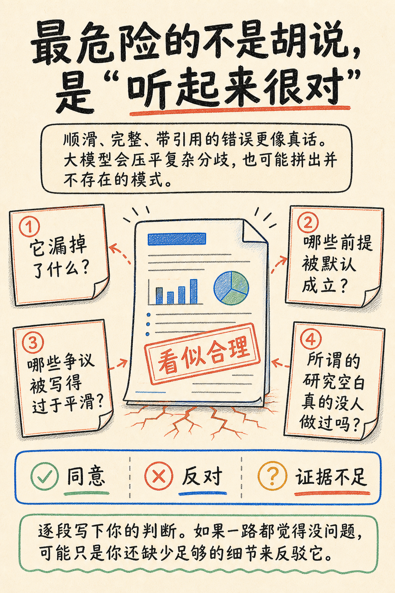
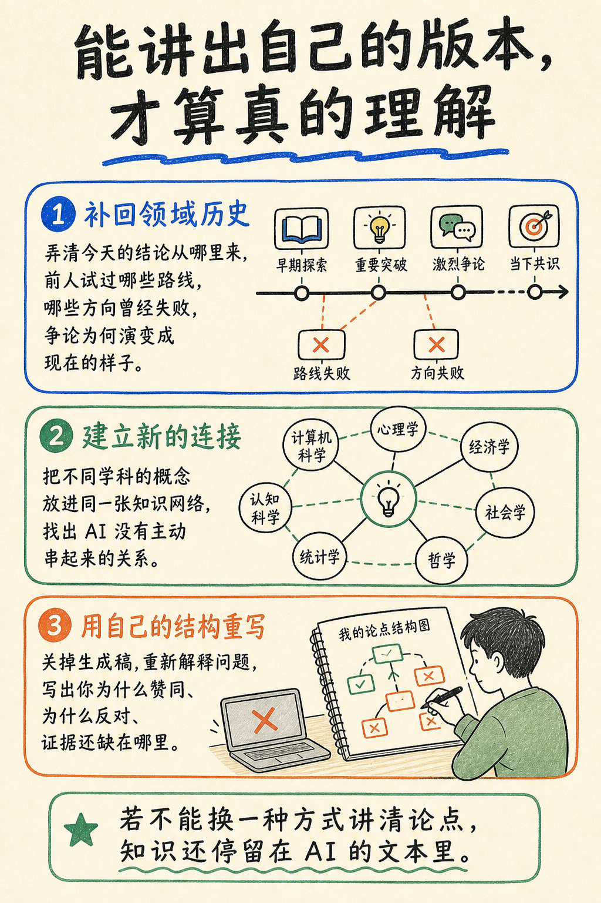
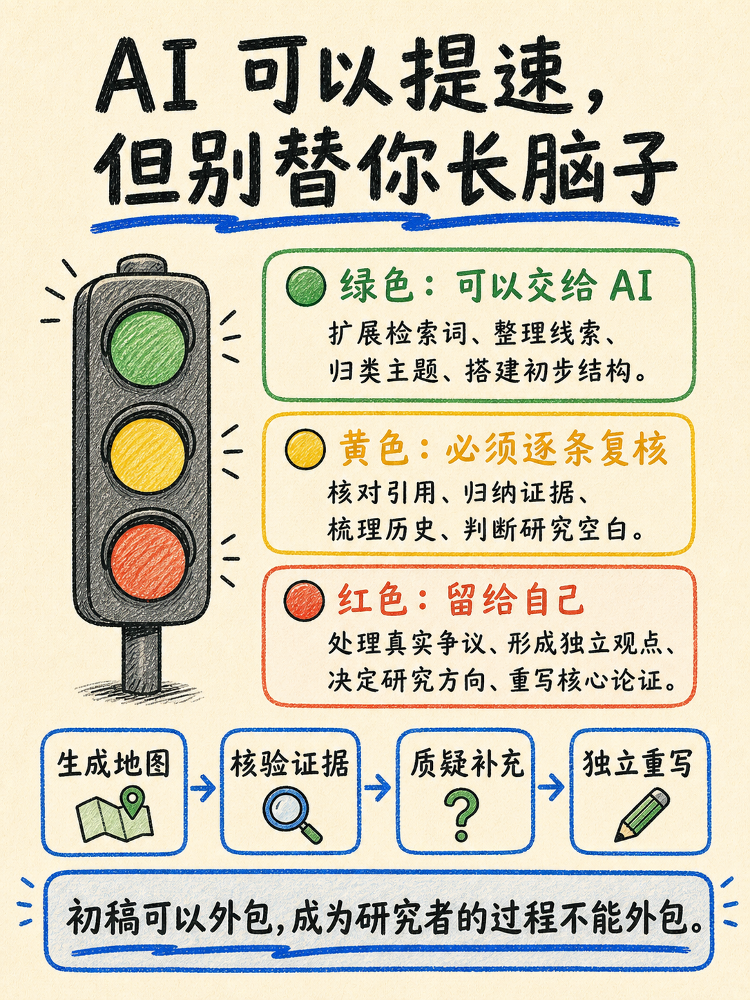

# 一条真实视频到图文的历史任务

[分析](analysis.md) → [正文](result/post.md) ＋ [六张方案](plan.md) → [六张生成原图](generated-originals/)；[修改反馈](conversation-excerpts.json)与[恢复清单](recovery-manifest.json)可交叉核对。

任务输入为 YouTube 视频 `1PSMmwQkqME`。用户在 2026-08-27 先要求分析，随后继续正文与配图，再明确要求“八张有点多了，6 张吧”“只看图片也能看懂”。本轮从同一聊天的文件读取输出、文件变更记录及 ImageGen 原图恢复材料，未执行历史命令，也未改动原工作目录。

analysis.md 恢复自完整文件读取输出；post.md 恢复自新增内容与随后一处原文修改；plan.md 使用六张版本；六张图片依据生成提示中的页号定位。原始生成图按字节复制、记录哈希。历史最终裁切／缩放后的发布文件尚未恢复，不能把原图称为最终 1152×1536 文件。

## 真实使用中的决策节点

用户先提交视频链接，确认分析后继续正文与配图；在八页规划阶段提出：

> 图片八张有点多了   6张吧   然后换个风格     除了首页每页内容稍微多一点  就是我只看图片 我也能看懂在说啥

摘录来源：[2026-08-27 的原始对话，line 214](conversation-excerpts.json)。这条反馈同时改变数量、视觉风格与阅读要求，不能仅将循环次数从八改成六。

| 对照 | 原规划 | 修订后的处理 |
| --- | --- | --- |
| 信息组织 | 效率冲击、综述目的分开讲 | 合为一页，直接建立“文档完成 ≠ 研究完成” |
| 风险解释 | 提问反驳、貌似可信分开讲 | 把问题及对应核查动作放在一起 |
| 阅读方式 | 八张研究手账风卡片 | 六张手绘解释图；内页补解释，图可以独立阅读 |
| 交接 | 正文与八页方案已生成 | 保留正文，修订规划后再出图 |

[原八页方案](plan-original-eight.md)与[修订六页方案](plan.md)保留全文。历史对话还有一次多余确认：用户说“可以”后助手仍停下来等待，再次收到“继续吧”才推进。这是交互中断问题，未包装成理想路径。

## 六张原图：按阅读顺序查看

<table>
<tr><th>01 · 中心冲突</th><th>02 · 效率边界</th><th>03 · 引用核查</th></tr>
<tr><td align="center"></td><td align="center"></td><td align="center"></td></tr>
<tr><th>04 · 提问反驳</th><th>05 · 历史与重构</th><th>06 · 行动方法</th></tr>
<tr><td align="center"></td><td align="center"></td><td align="center"></td></tr>
</table>

原图按相同显示高度排列，文件本身未裁切或修改。点击可查看完整尺寸。正文是独立产物：[阅读完整图文正文](result/post.md)。

## 本轮内容复核

| 检查点 | 输入与产物对应 | 结果 |
| --- | --- | --- |
| 中心命题 | 文档生成不等于研究能力；正文及第 1–2 张 | 对应 |
| 引用核查 | 存在、相关、支持与回原文；第 3 张 | 对应 |
| 质疑与分歧 | 查遗漏、前提、争议、研究空白；第 4 张 | 对应 |
| 历史和独立表达 | 历史脉络、跨学科、重构；第 5 张 | 对应 |
| 行动建议 | 交通灯和四步核验；第 6 张 | 对应分析中的二创组织，不冒充逐字原述 |
| 数字范围 | 62 页、160 条来自来源视频展示的一次案例 | 卡片容易被读成通用能力；展示时必须解释限定 |
| 原图规格 | 4 张 1024×1536，2 张 1086×1448 | 原始生成未统一 3:4，见 image-check.json |

六张图已逐张目视复核：主要文字可读、叙事覆盖五项重点，未发现关键内容被截断。此处为本轮 AI 辅助审校，不冒充用户最终验收。数字案例不是准确率、费用或本工作流节省时间的证明。

从首次链接消息 13:58:33 到最后交付消息 14:26:47，历史会话跨度约 28 分 15 秒，其中包含等待和确认，不能当作主动人工时间或纯生成耗时。模型费用与用户采纳仍无完整记录。本轮证明的是任务关联、真实调整及输入输出覆盖，未重新跑字幕获取和图片生成。
