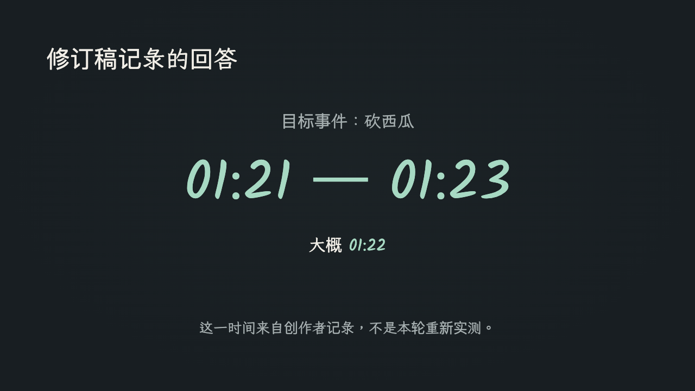
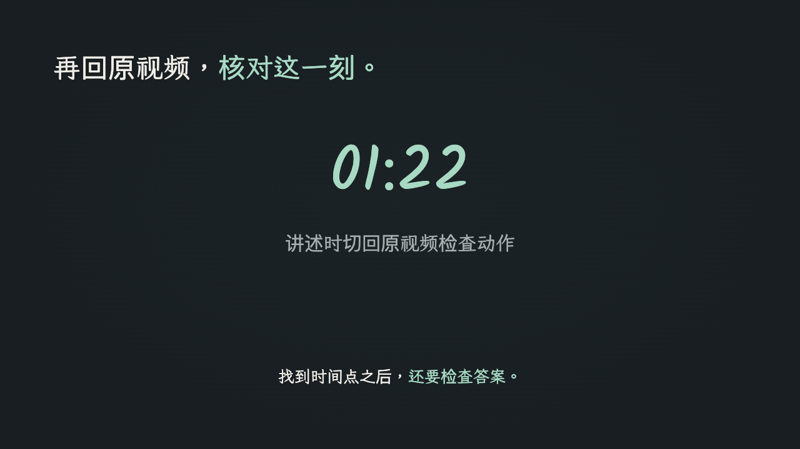

# 第 005 期：版本对齐与复核

[播放修订演示](ppt/001.html) · [历史原件](../2026-09-26-agentic-video/artifacts/ppt/001.html) · [输入修订稿](../2026-09-26-agentic-video/input-script-revised.md) · [检查报告](browser-check.json)

2026-10-16，我根据修订稿调整第 5–7 页。第 5 页依次呈现两次 Processing Call，第 6 页呈现修订稿记录的 01:21–01:23，第 7 页提示回到视频核对 01:22。删除初版中修订稿不再讲述的采样放大和转录示意，保留 15 页和其余讲述顺序。页面中的过程依据口播记录呈现，属于讲解演示；原识别工具的操作过程仍需查看视频。

修订后逐页查看全部 15 页完成状态，并检查第 5、6、7、13 页的中间状态；1280×720 播放遍历 42 个节点，无页码／步数错位、舞台越界、远程请求或脚本错误。390px 窄屏舞台为 390×219.375，保持 16:9。原生桌面全屏未验证。几何检查的 review 提示是待解释的启发式信号，不能当成事实错误或全部忽略。

内容对照：第 1–4 页承接开场、抽帧与成本权衡；第 5–7 页对齐两次请求和时间回答；第 8–10 页解释视频角色与 Context；第 11–15 页承接人准备上下文到 AI 主动获取的变化。15 页完成画面未发现裁切或遮挡；新增中文采用原字体与系统回退，跨平台字形不保证完全一致。

88% 保留“Google 基准测试中最多减少 Token”的限定；已核对 [Google 原文](https://blog.google/innovation-and-ai/models-and-research/gemini-models/introducing-agentic-video-in-gemini/)，它不属于本项目的效率测量。两次调用和时间回答来自用户历史稿，未独立重跑视频识别实验。

[交接清单](handoff.json)固定修订稿、演示、发布文案和三张封面的 SHA-256。运行 `python3 src/script-workflow/check_handoff.py demo/script-workflow/2026-10-16-version-alignment/handoff.json`（项目根目录）可发现验收后的文件变化。它只能提示需重新审核，不能自动证明语义一致。历史产物均未覆盖，该修订没有重新生成封面或视频。

## 使用过程截图：在口播中逐步展开

用户打开 HTML 后，点击画面或按右方向键推进一步；左方向键回退，R 重播当前页。下面是同一页两个真实播放状态，说明它如何配合口播控制信息出现，而不是将整页文字一次性铺开。截图来自 2026-10-16 加载修订 HTML，不是历史操作录屏。

| 第 5 页初始状态 | 逐步推进后的完成状态 |
| --- | --- |
|  |  |

**用户检查什么：** 页面是否与讲到的内容同步；下一步是否引入新信息；回退后是否能重新讲述。这比“生成了 15 页”更接近实际使用标准。

## 修订后页面

下图来自实际加载修订 HTML 的浏览器截图，分别呈现两次请求、时间回答与回到视频核对的顺序。它们是口播配套画面，不是原视频识别工具的操作截图。

