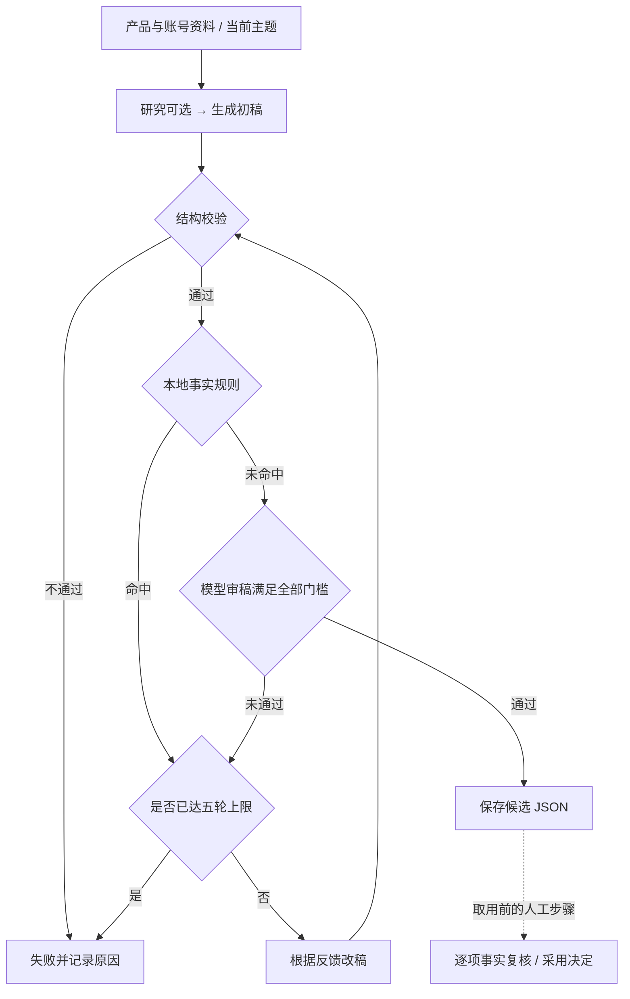

# 运行架构与材料边界

[返回项目首页](../README.md) · [运行步骤](quick-start.md) · [产品决策](case-study.md)

## 1. 四个独立模块

content-workflow 由三个 Skill 共享分析并分别生成正文与图片；script-workflow 的演示和文案读取原稿，封面承接当前文案。两者由宿主 Agent 按 Skill 约定执行。

content-agent 由 Python 组织研究与审改；daily-trend-radar 由 Node 采集，再由 Agent 回查与形成角度。content-agent 内部热点研究与 radar 有重叠，但数据结构和调用范围不同，目前未合并。四个模块之间通过明确材料交接，没有中央调度器。

## 2. 内容 Agent 的审改循环

以下为仅生成草稿路径的简图。结构校验失败可直接报错；本地事实规则命中时跳过模型审稿，形成改稿反馈。通过需要总分、多个分项和阻断项同时满足，不能只看模型 passed 字段。

默认整体门槛为 8.6，其余分项与停止条件以 [runtime.py](../src/content-agent/src/create/runtime.py) 为准；这些阈值是当前规则，尚未通过外部标注验证其合理性。图中的人工复核不属于程序强制发布闸门，需使用 `--no-publish` 限定草稿路径。

## 3. 数据如何流动与保存

| 数据 | 当前载体 | 边界 |
| --- | --- | --- |
| 长期上下文 | content-agent 的四份固定账号／平台文件、products 下的 Markdown | 文件式上下文；新增目录不会自动成为记忆，需经确认维护输入 |
| 本期创作 | analysis.md、plan.md、原稿、post.txt、图片和 HTML | 按任务路径关联；PPT 与 post 编号独立 |
| 审改与运行 | JSON 草稿、JSONL 日志、来源报告 | 保存模型反馈、运行原因；日志不完整时保留未知字段 |
| 验收版本 | script-workflow 的 handoff.json 与 SHA-256 | 检测验收后变更，不自动判断语义一致性 |

模型调用与图像生成依赖宿主或外部服务；稳定规则由程序执行。源码、原件、当前修订与未来设计分别记录，以便解释实际已经实现的范围。

## 4. 项目材料归属

| 位置 | 内容 | 与其他材料的关系 |
| --- | --- | --- |
| 项目 README | 一句话定位、四个板块、重要结果、当前阶段和阅读入口 | 招聘方的独立阅读入口，链接案例与代表性产物 |
| docs/architecture.md | 本文：整体范围、板块关系、材料归属与推进顺序 | 定义建设规则，不重复各板块详细设计 |
| docs/evidence-notes.md | 实际使用记录、实现依据、当前本地线索与核验边界 | 支持设计追问；不替代完整演示与效果测量 |
| docs/case-study.md | 整个内容生产案例的主线、代表性取舍、结果和限制 | 从四个板块提炼，链接具体证据，不复制四篇文档 |
| docs/<板块>.md | 用户任务、原流程痛点、首版范围、输入输出、过程与失败分支、方案比较、实现状态、迭代记录 | 需求与设计先写在一份文档中，复杂到影响阅读时再拆分 |
| src/<板块>/ | Skill、程序、资源、配置与工程测试 | 实现与运行说明随代码维护 |
| demo/<板块>/<任务>/ | 同一真实任务的输入、最终产物、必要截图或录屏 | 供演示与评测共同引用，不把不同任务产物拼成一次运行 |
| evaluation/<板块>/ | 验收标准、样本条件、运行记录、结果、失败分析与结论 | 引用 demo 的任务及代码版本，不再复制整套产物 |

四个板块统一使用表中名称作为目录名、文档名和新评测记录的 workflow 值。原方案中的 youtube-social、script-assets、product-content、trend-radar 是旧别名；说明已更新；若发现真实历史记录则保留原值并说明映射。

同一任务通过任务标识、明确路径和版本关联。script-workflow 的 task 标识不改变原有 PPT/post 编号规则。未能取得的费用、耗时和历史事实留空或标注待补。

## 5. 来源与历史迁移

| 迁移前路径 | 当前路径 |
| --- | --- |
| workflows/social-content-skills/ | src/content-workflow/ |
| workflows/script-workflow/ | src/script-workflow/ |
| workflows/content-agent/ | src/content-agent/ |
| tools/daily-trend-radar/ | src/daily-trend-radar/ |

sources.json 的 path 已指向当前真实目录；repo、commit、tree 等来源字段保持原始语义。迁移后重新执行了现有离线测试与 CLI 检查，结果见本轮结构验证记录。目录迁移阶段未改执行逻辑。后续作品集副本新增交接检查，并修复雷达失败报告、内容 Agent 保存计数及审改提示；原仓库未改，差异已登记在 sources.json。
