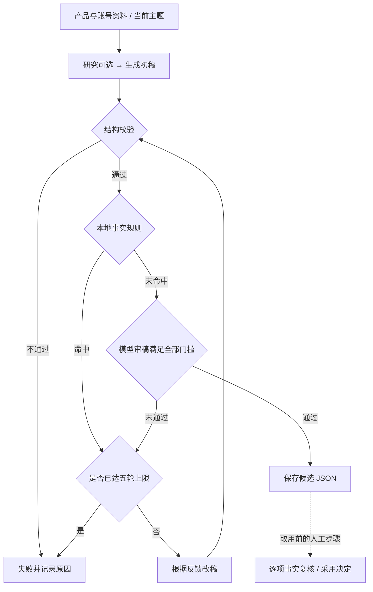
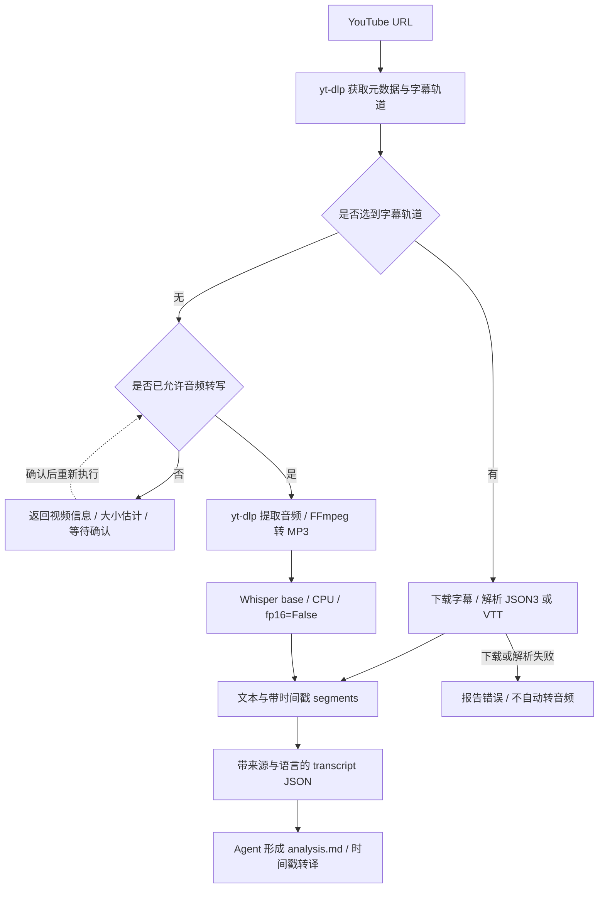

# 运行架构与材料边界

[返回项目首页](../README.md) · [运行步骤](quick-start.md) · [产品决策](case-study.md)

## 1. 四个独立模块

content-workflow 由三个 Skill 共享分析并分别生成正文与图片；script-workflow 的演示和文案读取原稿，封面承接当前文案。两者由宿主 Agent 按 Skill 约定执行。

content-agent 由 Python 组织研究与审改；daily-trend-radar 由 Node 采集，再由 Agent 回查与形成角度。content-agent 内部热点研究与 radar 有重叠，但数据结构和调用范围不同，目前未合并。四个模块之间通过明确材料交接，没有中央调度器。

## 2. 内容 Agent 的审改循环

以下为仅生成草稿路径的简图。结构校验失败可直接报错；本地事实规则命中时跳过模型审稿，形成改稿反馈。通过需要总分、多个分项和阻断项同时满足，不能只看模型 passed 字段。

默认整体门槛为 8.6，其余分项与停止条件以 [runtime.py](../src/content-agent/src/create/runtime.py) 为准；这些阈值是当前规则，尚未通过外部标注验证其合理性。图中的人工复核不属于程序强制发布闸门，需使用 `--no-publish` 限定草稿路径。

## 3. 数据如何流动与保存

| 数据 | 当前载体 | 边界 |
| --- | --- | --- |
| 长期上下文 | content-agent 的四份固定账号／平台文件、products 下的 Markdown | 文件式上下文；新增目录不会自动成为记忆，需经确认维护输入 |
| 本期创作 | analysis.md、plan.md、原稿、post.txt、图片和 HTML | 按任务路径关联；PPT 与 post 编号独立 |
| 审改与运行 | JSON 草稿、JSONL 日志、来源报告 | 保存模型反馈、运行原因；日志不完整时保留未知字段 |
| 验收版本 | 作品集整理阶段补充的 script-workflow handoff.json 与 SHA-256 | 检测验收后变更，不自动判断语义一致性；不追溯为历史生产能力 |

模型调用与图像生成依赖宿主或外部服务；稳定规则由程序执行。源码、原件、当前修订与未来设计分别记录，以便解释实际已经实现的范围。

## 4. 字幕获取与 Whisper 降级

源码：[youtube_transcript.py](../src/content-workflow/skills/yt-analysis/scripts/youtube_transcript.py)；调用约定：[yt-analysis](../src/content-workflow/skills/yt-analysis/SKILL.md)。

**选择策略。** 指定 `--lang` 时，在该语言内先人工、后自动字幕；未指定时，先尝试视频原语言，再依次考虑 en、en-orig、zh-Hans、zh-Hant、zh，最后选择其余轨道。每个语言候选内人工优先，因此不能笼统解释为“任何人工字幕都优先于原语言自动字幕”。显式指定的语言缺失会报错；只有没有选到轨道的分支才进入 Whisper 确认流程。

**降级条件与执行。** 没有轨道且未传 `--allow-whisper` 时，返回 `whisper_confirmation_required`、标题、时长和估计音频字节数，退出码为 3。获得许可后再执行：下载并提取 MP3，加载本 Skill `models/` 下的 Whisper `base`，用 CPU 与 `fp16=False` 转写。模型资源可缓存复用；音频位于临时目录，只有 `--keep-audio` 才额外复制保留。

**数据契约。** 两条路径均写出文本和 transcript JSON，包含 `source`（manual / automatic / whisper-base）、语言、原视频信息及 `start_seconds / duration_seconds / text` 片段。Agent 完整读取后写入 `analysis.md`。JSON3 与 VTT 解析处理重复字幕；下游可以沿时间戳复核关键语句。按 Skill 约定，临时字幕与音频在完成分析后清理，不是默认永久存储的用户资料。

**取舍与现状。** 字幕优先省去不必要的音频下载和 ASR 推理；本地 base 提供无字幕时的补充路径，代价是 CPU 等待、专有名词识别和标点误差。它只能理解音轨，不能补出画面事实。代码实现已核对，但尚未测量 Whisper 实际执行耗时或转写错误率；历史图文任务不能据最终 analysis.md 反推出当时必定使用了 Whisper。字幕下载失败也未实现自动切换转写，这与“根本没有字幕轨道”是不同异常。

## 5. 出图后端、参考图与修订控制

### 当前 Skill 路径

- **图文卡片：** [note-images](../src/content-workflow/skills/note-images/SKILL.md) 将确认后的页面文字、版式和风格写入逐图提示词，使用原生 imagegen 能力；先出封面，再将封面作为后续页的风格参考。失败项只重试一次，已成功图片不整套重做。该 Skill 的卡片方法来自 `baoyu-xhs-images`，来源方法与实际出图后端是两层。
- **三比例封面：** [script-to-image](../src/script-workflow/script-to-image/SKILL.md) 使用内置 `image_gen`。先检查主设计，再为 4:3、16:9 分别构图，同时传入原始人像和主设计，避免从已漂移的人脸持续衍生。默认每个画幅首稿后最多两次有明确目的的修订。
- **输入控制：** [生成约定](../src/script-workflow/script-to-image/references/generation.md) 区分人物身份参考与风格参考，锁定本期文字和需保留元素；使用实际工具支持的参考图参数。目标像素写入提示，不虚构工具未提供的 size、quality 或 model 参数。
- **输出验收：** 从工具返回的真实文件取用原图；检查命名、解码、尺寸和比例，再人工检查中文、人物和视觉关系。比例合格不代表内容合格。三种画幅分别生成，不靠拉伸一张图交付三种比例。

这是模型能力与产品验收的分工：提示词表达期望，参考图传递不变量，检查器验证确定性规格，人工判断身份与语义。当前示例可证明内置图像工具被使用，未取得可核验的底层模型标识，不能仅凭工具名将历史图片标成某个模型版本。

### 仓库中的 gpt-image-2 API 实现

[image_generator.py](../src/content-workflow/skills/note-writer/scripts/image_generator.py) 定义 `GptImage2Generator`，默认 `GPT_IMAGE_MODEL_NAME=gpt-image-2`，使用配置的服务地址与 API Key。以下是这份脚本的实际逻辑，不等同于当前主流程已调用它，也不构成对任何服务当前兼容性的保证。

| 机制 | 代码行为 | 使用边界 |
| --- | --- | --- |
| 端点选择 | `GPT_IMAGE_ENDPOINT` 默认 chat；可选 images / auto。auto 无参考图时先 images、失败再 chat；images 模式带参考图时走 chat | 该兼容实现的协议选择，不是工具层自动切换模型 |
| 返回解析 | 接收图片 URL、data URL 或 base64 并落盘 | 文件存在后仍需校验实际格式和可解码性 |
| 瞬态错误 | 对指定的 5xx、超时与断连文本，每个比例轮次最多三次尝试，间隔固定 5 秒 | 这是固定延迟重试，不是指数退避；重试可能增加费用 |
| 比例重生 | 比例偏离时最多额外重生两次，默认容差 15%；用 PNG 头读取尺寸 | 未覆盖 3:4 / 4:3 目标映射，达到上限会保留不合格结果；不能直接作为三比例封面验收器 |

当前 [note-writer](../src/content-workflow/skills/note-writer/SKILL.md) 只写 `post.md`，明确不出图；仓库内未找到其他生产入口调用该生成类。它目前是**保留的 API 实现**，尚未接入默认工作流或自动备用通道。若要正式接入，应先补齐比例映射、失败验收与服务实测，再将调用、用量和模型标识写入新任务记录。

note-images 下另有 `codex-imagegen` wrapper 与 backend 偏好等参考文件，但当前主 SKILL 的执行规则是原生工具；参考文件存在不代表整套后端路由已经实现。内容 Agent 的发布模块还保留 [Pillow 文字卡片生成](../src/content-agent/src/publish/assets.py)，用于发布素材准备，它与模型生成的图文卡片和人像海报不是同一产物路径。

## 6. 模型调用：传输回退、结构纠正与内容审改

源码：[llm.py](../src/content-agent/src/base/llm.py)、[json_utils.py](../src/content-agent/src/base/json_utils.py)、[research_infra.py](../src/content-agent/src/research/research_infra.py)。

| 层次 | 触发条件与当前处理 | 为什么分层 |
| --- | --- | --- |
| 模型与接口 | `MODEL` 可配置，默认值为 `deepseek-v4-flash`；服务地址由 `OPENAI_BASE_URL` 配置，以 OpenAI 兼容 chat completions 请求 JSON | 固定业务输出约定，保留更换服务配置的入口；没有做模型优劣对照 |
| 传输 fallback | SDK 抛 `OpenAIError` 且配置了 base_url 时，改用 urllib HTTP；urllib 的 URL / 超时错误再改用 curl。后两者各有 60 秒超时；HTTP 错误不继续转 curl | 保持同一服务与模型，仅更换请求实现，不能解决服务本身不可用或内容错误 |
| JSON 纠正 | 非合法 JSON 对象时，附上原返回和纠正要求，默认最多两次逻辑调用 | 修复响应格式，不触发内容质量评分 |
| 研究 Schema 纠正 | Pydantic 校验不通过时，附具体字段错误，默认最多两轮 Schema 尝试；每轮仍经过 JSON 层 | 合法 JSON 也可能缺必需字段；嵌套重试会放大调用量 |
| 内容审改 | 本地事实 guard 与模型 reviewer 给出反馈，由 editor 修改，默认最多五轮 | 事实、结构和风格分别定位；不能把传输成功当作质量通过 |

**可观测性与代价。** 日志记录阶段、逻辑调用耗时、模型及服务 host、成功／失败与可用 Token。当前 HTTP / curl 回退仅返回文本，没有把服务 usage 传回统计；缺失 Token 应保持未知。SDK 内部重试、传输回退、结构纠正与内容审改会叠加，不能把“最多五轮”写成“最多五次网络请求”。当前也没有跨层统一预算上限；下一步需按任务汇总实际请求与费用，而不是直接增加轮次。

## 7. 雷达：超时、退避与部分失败

源码：[fetch.mjs](../src/daily-trend-radar/scripts/core/fetch.mjs)、[platform-lanes.mjs](../src/daily-trend-radar/scripts/core/platform-lanes.mjs)、[run.mjs](../src/daily-trend-radar/scripts/run.mjs)。

- **Backoff：** 通用请求默认每次 10 秒超时，初次之外最多重试两次，等待 `300 × 2^attempt` 毫秒，即默认两次等待为 300 / 600 ms。401、403、429 直接返回错误，不做通用重试；部分适配器显式设 `retries: 0`，因此不是所有来源固定请求三次。
- **请求组织：** 不同平台并发，同一平台的来源串行，减少同平台同时请求。一个来源异常在该来源内捕获，其他来源仍可返回；全部失败时先落报告再非零退出。
- **适配器 fallback：** 例如[微博](../src/daily-trend-radar/scripts/sources/weibo.mjs)优先 JSON 热榜；有 Cookie 且符合回退条件时可解析 HTML 榜单。缺少必要 Cookie 时明确失败，不将空白页当成榜单。
- **时间与归并：** `fetchedAt` 和 `publishedAt` 分开；按时间窗口筛选时保留发布时间未知的条目，不能据此声称全部为近期发布。标题以规范化、包含关系与字符 bigram 相似度归并，默认阈值 0.88，保留 related 来源。这是启发式归并，不是模型语义去重。

这里的 10 秒限制针对单次请求，不是整份报告的总时限；适配器多请求、重试与平台串行都会影响总等待。此前通过代理恢复是运行环境调整，并未实现自动探测代理或自动切换网络。三次实采验证的是当时三源可用，不包含所有适配器的降级实测。
