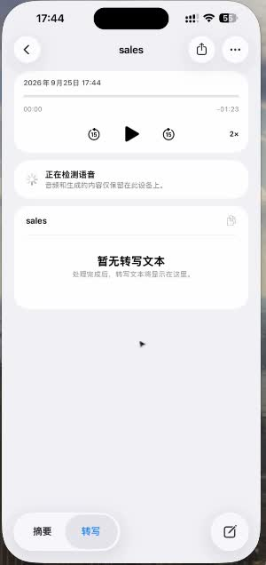
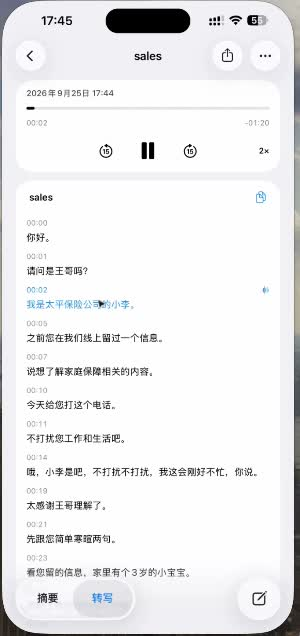
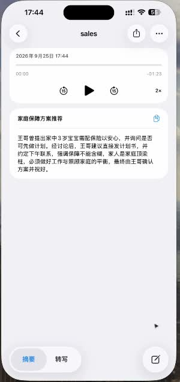
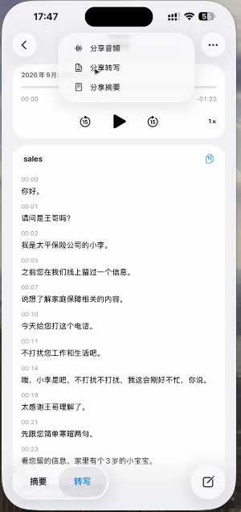
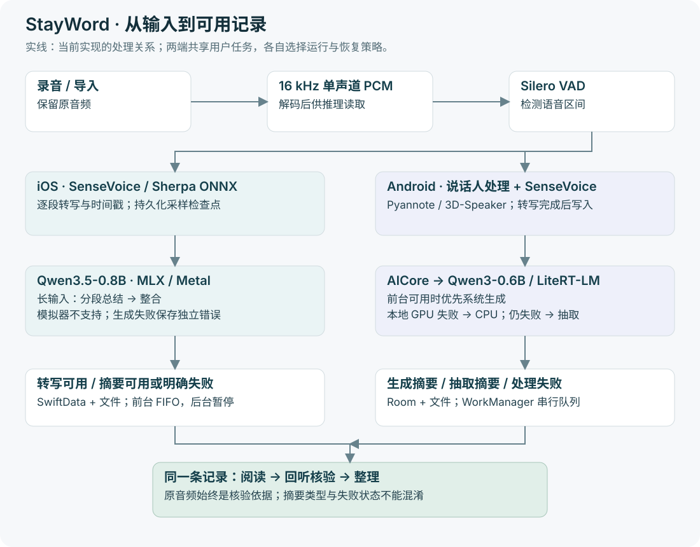

# StayWord

**把录音变成可以阅读、回听和继续整理的本地笔记。**

StayWord 在设备上完成录音、音频导入、转写与摘要，保留时间戳和原音频，支持回听、编辑与资料管理。产品设计与双端工程独立完成。这个案例关注：在手机内存、后台运行和模型能力的约束下，如何交付一条可靠的 AI 使用流程。

[实机介绍视频 · 2 分 49 秒](demo/assets/stayword-demo-2026-09-25.mp4) · [产品决策](docs/case-study.md) · [技术方案](docs/technical-design.md) · [Quick start](docs/quick-start.md) · [验证与局限](evaluation/README.md)

## 从一段录音到一份可回查的笔记

下面来自 **2026-09-25 的历史实机演示**：导入一段约 1 分 23 秒的 `sales` 音频，查看处理进度、转写和摘要，再回听与整理。截图提取自同场原始录屏中的手机区域，未重绘界面。演示版本与当前工程快照分别说明，不能用视频剪辑计算处理速度。点击图片可查看原图。

| ① 导入已有音频 | ② 看见任务进度 | ③ 阅读转写并回听 |
| --- | --- | --- |
|  |  |  |

| ④ 阅读生成的摘要 | ⑤ 选择要带走的产物 | ⑥ 收藏后再次找到 |
| --- | --- | --- |
|  |  |  |

**同一条记录交付原音频、分段转写、摘要和整理入口。** 用户可以先读概述，再回到原话；有修改或复用需求时，仍能选择具体材料。分享入口证明演示中存在该操作，不代表本轮验证了每一种导出格式。

演示摘要标题为“家庭保障方案推荐”，正文涉及家庭保障需求、发送计划书与后续联系。它展示了摘要的组织形式；专名、数字和行动归属仍应对照音频核验，不能仅凭读起来流畅就判断准确。时间点与素材来源见[演示记录](demo/README.md)。

## 为什么这样定义产品

录音保存了信息，却没有解决“之后怎样找到、理解和使用它”。先聚焦需要回查谈话内容的个人任务：已有一段录音，希望快速了解重点，并能确认原话。会议、访谈、学习是可扩展场景，不把一条演示写成覆盖所有场景的用户研究。

| 用户要完成的事 | 产品选择 | 代价与边界 |
| --- | --- | --- |
| 随时记录或导入已有内容 | 录音与文件导入共用后续处理链路 | 权限、解码和存储失败分别处理 |
| 不上传谈话也能整理 | 端侧 ASR 与摘要、本地存储 | 模型增加安装体积，占用内存；能力取决于设备 |
| 知道系统在做什么 | 准备、语音检测、转写、摘要分阶段反馈 | 状态完成不代表内容质量通过 |
| 摘要有疑问时确认原话 | 保留原音频、时间戳与播放器 | 回查能降低误用风险，不能消除识别错误 |
| 中断后继续使用 | 串行调度、持久化状态、保留已有产物 | 两端恢复粒度不同，不能笼统宣称断点续跑 |

先把“记录—理解—核验—整理”做完整，再考虑云同步或对话式检索。端侧路线降低上传依赖，同时把兼容性、存储和长任务体验变成必须解决的产品问题。

## AI 如何工作，失败后留下什么

| 环节 | iOS 工程快照 | Android 工程快照 |
| --- | --- | --- |
| 音频与转写 | AVFoundation → 16 kHz 单声道 PCM → Silero VAD → SenseVoice；Sherpa ONNX | MediaCodec / PCM → Silero VAD → Pyannote + 3D-Speaker → SenseVoice；Sherpa ONNX |
| 摘要 | Qwen3.5-0.8B 4-bit / MLX；约 10,000 字符分块，长输入分段总结再整合 | 前台且 AICore 可用时尝试系统生成；否则 Qwen3-0.6B INT4 / LiteRT-LM；GPU 失败尝试 CPU |
| 降级交付 | 摘要失败后保留转写，单独保存摘要错误 | 生成失败或结果与原文归一化后完全相同：确定性抽取摘要，保存类型 |
| 长任务 | 前台串行 FIFO；切后台取消计算、保留转写检查点，返回后续跑 | WorkManager 全局串行链；恢复任务重新进入处理流程 |
| 持久化 | SwiftData + 音频文件 | Room + 音频文件；模型安装校验大小与 SHA-256 |

“降级成功”只表示仍有产物可用。抽取摘要不等价于生成摘要，转写可用也不等于摘要已完成。模型限制、两端行为和代码定位见[技术方案](docs/technical-design.md)。

## 已有结果与下一轮验证

- **交付证据：**历史实机视频展示导入后的处理、转写、摘要、回听和收藏，包含分享入口；完整视频保留在项目中。
- **发行证据：**[App Store 页面](https://apps.apple.com/app/id6795797415)存在；2026-10-17 官方接口返回版本 1.0.2、9 个评分、均分约 4.89。小样本评分作为发行与早期反馈线索，不推导活跃、留存或商业效果。[查询快照](evaluation/app-store-snapshot.json)
- **工程证据：**本轮 iOS 模拟器的 29 项现有单元测试全部通过，覆盖分块、解析、队列和检查点等；Android 本轮未运行。详细范围见[验证记录](evaluation/README.md)。历史演示不能替代当前版本真机测试。
- **下一优先级：**固定音频集，同时测转写错误、摘要事实性、完成时间与中断恢复。先找出“能出结果但不能放心使用”的失败类型，再做速度优化。暂不把“最高 60×”宣传文案作为基准成绩。

## 继续查看

| 想看什么 | 入口 |
| --- | --- |
| 定位、取舍与验收设计 | [产品案例](docs/case-study.md) |
| 模型、分块、调度与已知不足 | [技术方案](docs/technical-design.md) |
| 构建与一条可执行体验路径 | [Quick start](docs/quick-start.md) |
| 实际素材与历史版本 | [演示与来源](demo/README.md) |
| 工程 | [iOS](src/stayword-front-ios/README.md) · [Android](src/stayword-front-android/README.md) · [官网源码](src/official-landingpage/products/stayword/index.html) |
