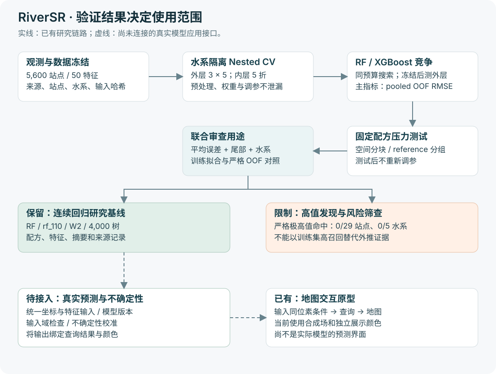
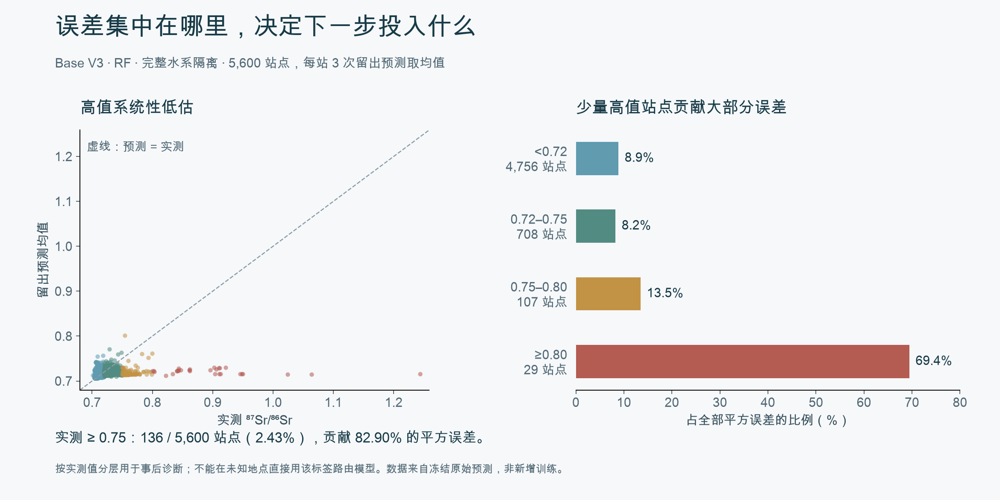

# RiverSR · 全球河水锶同位素预测与应用研究

**为未采样河流建立预测基线，让研究者知道结果能支持什么判断、哪些环境仍需补充证据。**

这是实验室与中科院合作背景下的科研项目。我独立完成这里展示的数据整理、特征工程、模型训练、验证与运行工程，并推进水生生物来源研究的应用设计。

河水的 **⁸⁷Sr/⁸⁶Sr（锶同位素比值）** 可以为环境差异与生物来源研究提供线索。但实测地点有限，模型在新水系、新环境和新资料来源上的表现未必一致。我把研究目标拆成三个任务：建立连续预测基线、界定适用范围、验证下游用途。

## 已交付什么，改变了哪些判断

| 交付 | 关键结果 | 对研究的意义 |
| --- | --- | --- |
| 数据与预测基线 | 5,600 站点；早期 Full50 特征、RF / XGBoost 最终模型、原始留出预测 | 形成可复现的输入—训练—验证—交付流程；后续扩展至 Natural90 自然环境主线 |
| 场景化评估与误差诊断 | 新支流与完整陌生水系分别验证；136 个高值站点贡献 82.90% 的平方误差 | 预测成绩与实际用途对应，后续投入聚焦困难环境与信息缺口 |
| 新信息的采用决策 | 同一批 5,517 站点配对检验 Human17，三算法均未通过整体增量标准 | 保留自然基线，暂不增加未经稳定收益支持的人类活动预测层 |
| 应用验证基础 | 生物基准扩展集合覆盖 20 个研究、14 个流域组，已冻结验证协议 | 进入独立水—生物对照准备阶段，来源推断与迁移重建仍需验证 |

[实际模型与结果](demo/README.md) · [需求、最小闭环与应用规划](docs/case-study.md) · [Quick start](docs/quick-start.md)

## 从最小研究闭环到应用验证

起步阶段，我优先完成**可信观测 → 环境输入 → 基线模型 → 留出预测 → 使用解释**。有了共同的数据与验证条件，再比较模型修正、区域化和新增信息；每一步都要回答是否值得继续投入。

架构图展示早期 Full50 / Base V3 的具体实现。后续 Natural90 / Human17 沿用数据冻结、隔离验证和用途验收原则，特征版本与模型配方分别管理。[技术方案](docs/technical-design.md)

## 让评估回答真实使用问题

**已有观测水系中的新支流，与完整陌生水系，是两种预测任务。** 简单留出支流还可能保留下游观测，使评估过于乐观。

我设计不依赖同位素响应的支流划分，并在训练和选参时剔除待测支流的下游站点。九套设计的四项预设指标均优于匹配的完整水系对照。在该阶段 2,577 个适用站点上，站点均值留出预测的 RMSE 为 0.01334、R² 为 0.425。

这支持为新支流建立单独的适用范围；面对陌生完整水系，仍使用更严格的隔离检验。两类成绩对应不同条件，不能互相替代。[支流验证设计与结果](src/river_sr/training/base/v2/RESULTS.md)

## 从平均误差走向投入决策

早期完整水系验证中，RF 的 pooled RMSE 为 **0.017235，比 XGBoost 低 2.76%**，我选择它作为该阶段连续预测基线。但平均表现尚不能说明高值发现是否可用。

原始逐站结果显示：实测 ≥0.75 的 **136 个站点仅占 2.43%，贡献 82.90% 的平方误差**。其中 29 个极高值站点在全量训练拟合中全部命中，在严格留出预测中却为 **0/29**。模型能够拟合这些样本，但高值信息没有可靠迁移到陌生水系。

因此，我保留连续预测研究基线，对高值发现单独验收。残差修正、区域模型与过程特征未通过各自标准后，停止继续叠加这些模块，将研究转向输入信息与失败环境。后续 Natural90 研究发现，74 个站点在五种迁移方案中均出现三算法共同失败，进一步聚焦了跨算法仍然困难的环境。

### 一个站点怎样影响使用判断

以 `bef26300f5bf4000` 为例，记录来自 Pain et al. (2025)，实测比值为 **0.896269**；三次严格留出预测分别为 **0.724092、0.726249、0.722047**。预测彼此接近，却一致低估：**重复稳定不能直接解释为结果可信。**

该例按极高值组内绝对误差中位排名选取，是历史评估回放。输入、文献来源、冻结划分和三次预测可以逐项追溯；分层使用已知实测值，仅用于事后诊断。[四类站点示例与原始数据](demo/README.md#单站复核输入留出结果与使用判断)

## 用增量实验管理模型复杂度

人口、土地利用、污水、采矿和坝库等信息具有领域意义，也会增加提取、更新和验证成本。我在**同一批 5,517 站点、同一测试划分**上比较自然环境基线与加入 Human17 后的结果，排除样本变化带来的干扰。

| 需要回答的问题 | 我的处理 | 决策依据 |
| --- | --- | --- |
| 新信息是否稳定有用？ | 比较三算法、五种迁移方案的配对误差与不确定性 | 仅一个算法×迁移组合达到实质改善，三算法均未通过整体标准 |
| 输入时间口径错误怎么办？ | 修复未执行 2015 年规则的坝库字段，重算配对人群；其他变量与自然主模型保持不变 | 在固定划分、候选、种子和标准下重分析，结论仍不支持整体增量 |
| 是否新增全球预测层？ | 保留 Natural90 主基线和 Human17 研究结果，暂不增加正式人类活动预测层 | 局部改善尚不足以支持新增复杂度；结论限定于当前代理变量的预测收益 |

这项工作把输入质量、对照设计和采用标准连成一次完整决策。[配对结果与数据修复](evaluation/later-research-records.md#3-human17修复时间口径后重跑配对实验)

## 训练工程：让实验可比较、可恢复、可交付

以早期 Base V3 为例，RF 与 XGBoost 在相同预算下比较：外层 3 次重复 × 5 折，内层 5 折完成选参，测试标签不参与早停或选择。

| 工程取舍 | 具体实现 | 服务的目标 |
| --- | --- | --- |
| 控制搜索投入 | 48 个粗筛结构 → 16 个细化结构，每个结构比较三套权重；Primary 配置预算 28,830 次 fit | 在可解释的计算预算内比较算法 |
| 把计算用在有希望的候选上 | RF 逐级增加树数；XGBoost 仅在内层早停 | 降低筛选开销，保留外层验证独立性 |
| 控制并行与恢复 | CPU / Slurm 任务编排、依赖调度、候选检查点；后续 Human17 只恢复 55 个输出失败任务 | 保护已完成计算，区分模型失败与交付失败 |
| 将结果交成可复核资产 | 冻结配方、预处理、分组、逐站预测、LFS 模型及哈希 | 将输入、模型和结论绑定到明确版本 |

Base V3 Primary 默认每任务申请 **16 CPU / 32 GiB**。这些是资源申请；配置 fit 数、实际耗时和账单分别记录。现有日志能追溯阶段与候选完成，完整分配核时和实际费用仍需调度计费资料。[训练参数、资源与成本口径](docs/technical-design.md#训练资源耗时与成本)

## 从模型产物到下一阶段应用

**现在可以直接查看或复核：**[RF 最终模型](src/river_sr/training/base/v3/release/model_bundle.rds)、[模型配方](src/river_sr/training/base/v3/release/rf_recipe.json)、[逐站留出预测](src/river_sr/training/base/v3/runs/base_v3_full_20260817_r2/reports/primary/site_oof_predictions.csv)、[数据与特征](src/river_sr/data/processed/training/sr_full50_v2.csv)。[Quick start](docs/quick-start.md)提供 LFS 下载与原始指标重算入口，无需重新训练。

下一阶段优先验证“预测水 → 实测水 → 生物记录 → 已知来源覆盖”，分别定位水预测、生物对应和来源推断的误差。生物基准已整理并冻结协议；严格集合仍集中于少数来源，因此先补独立性、完成预测对照，再推进迁移案例。[目标使用流程与优先级](docs/case-study.md#一次研究使用应拿到什么)

**研究范围：**Full50 / Base V3 提供原始模型与结果；Natural90 / Human17 和生物基准目前按历史执行回报呈现，具体口径见[后续研究记录](evaluation/later-research-records.md)。不同阶段不拼接为性能增长曲线。地图交互原型使用合成场，在[成果页](demo/README.md#地图原型探索研究结果的查询方式)单独展示。
