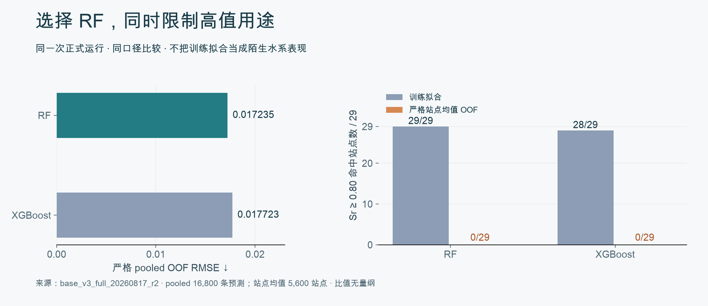
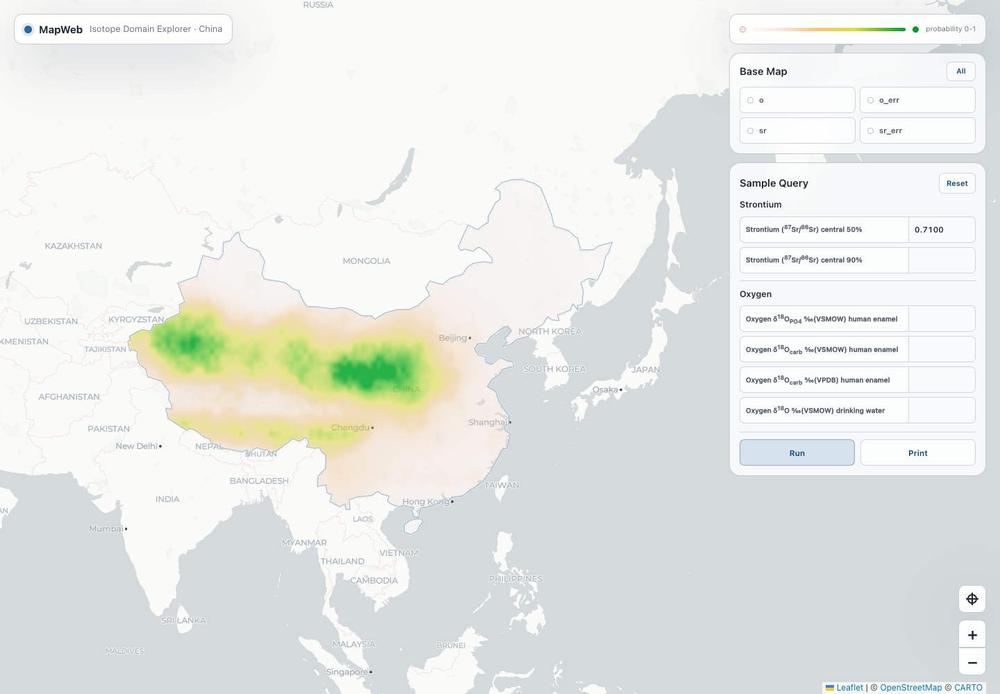

# RiverSR · 研究成果与应用交付

[返回项目](../README.md) · [研究需求与应用设计](../docs/case-study.md) · [Quick start](../docs/quick-start.md)

本页先展示模型结果如何影响交付，再提供数据与模型文件入口。后期 Natural90 / Human17 目前收录执行回报；下方地图则是早期合成数据原型，两者分别标明。

## 模型结果如何改变交付范围

**这张图回答两个不同的采用问题。** 左图中，相同完整水系隔离验证下，RF 的 pooled RMSE 为 0.017235，比 XGBoost 低 2.76%，因此选择 RF 作为 Base V3 连续预测基线。右图中，RF 训练拟合可以命中全部 29 个极高值站点，严格站点均值留出预测却为 0/29，因此没有将这一模型交付为可靠的极高值发现工具。

这个结果推动后续研究从模型修正、区域化，转向更完整输入和跨算法共同失败诊断。**保留的能力是连续预测研究基线，需要继续解决的是陌生环境与极高值迁移。**

图表由 [render_figures.py](render_figures.py) 读取 Base V3 冻结 CSV 生成。[算法比较数据](../src/river_sr/training/base/v3/validation/primary_pooled_metrics.csv) · [站点级汇总](../src/river_sr/training/base/v3/validation/primary_site_mean_metrics.csv) · [训练拟合](../src/river_sr/training/base/v3/release/training_metrics.csv)

## 交付文件：从输入追溯到结论

这里提供早期 Full50 阶段的一条完整阅读路径：先确认样本与特征，再看模型配方、验证方式和最终结论。

| 阅读顺序 | 可直接查看的产物 | 能回答的问题 |
| --- | --- | --- |
| 1 · 输入 | [5,600 站点 manifest](../src/river_sr/data/processed/training/sr_full50_v2_manifest.json) · [Full50 定义](../src/river_sr/training/base/v3/release/full50_predictors.txt) | 训练使用了哪些样本与信息？ |
| 2 · 模型 | [RF 配方](../src/river_sr/training/base/v3/release/rf_recipe.json) · [预处理统计](../src/river_sr/training/base/v3/release/training_medians.csv) | 参数、缺失处理与最终配方是什么？ |
| 3 · 验证 | [科学设计](../src/river_sr/training/base/v3/SCIENTIFIC_DESIGN.md) · [严格验证摘要](../src/river_sr/training/base/v3/validation/README.md) | 结果对应哪种预测情境，有没有泄漏？ |
| 4 · 结论 | [冻结结论](../src/river_sr/training/base/v3/release/scientific_conclusion.md) · [版本与哈希](../src/river_sr/training/base/v3/release/final_manifest.json) | 哪些能力得到支持，这些结果属于哪个版本？ |

模型二进制与完整 HPC 归档未随作品集附带；这些文件支持阅读和轻量复核，运行冻结模型还需要对应权重。

## 后续成果：自然基线、信息增量与应用基准

| 研究交付 | 当前可读结果 | 对应原始成果 |
| --- | --- | --- |
| Natural90 可靠性 | [5,543 站点、三算法共同失败与环境域](../evaluation/later-research-records.md#2-natural90-共同失败与环境域) | 回报中的 Figure 7、Tables S15/S16；后期全球预测图需补回对应原件 |
| Human17 增量价值 | [15 个算法×迁移组合的配对结果](../evaluation/later-research-records.md#3-human17修复时间口径后重跑配对实验) | 时间规则修复后的 Tables S4/S5/S11/S12、Figure S6 与校验清单 |
| 生物应用准备 | [严格/扩展集合与独立性限制](../evaluation/later-research-records.md#4-应用验证先建立独立生物数据再评价地图) | 冻结 population registry、study summary 与 benchmark protocol |

这部分依据历史执行回报整理，原图、完整模型与逐折结果尚未随仓库收录。生物基准目前完成数据与协议准备，尚未完成预测对照和来源验证。

## 地图原型：探索研究结果的查询方式

**已有合成数据原型，尚未连接真实模型。**

使用流程：输入同位素条件 → 点击 Run → 查看空间展示 → 修改条件并重新查询。截图来自 2026-10-17 运行的 `sr_o_map_web_pro`，Strontium central 50% 输入 0.7100，其余输入为空。

原型已经组织了输入与地图展示，但地图颜色尚未直接消费查询输出，不能据此解释实际来源概率。真实接入需依次完成：查询数值与颜色一致、坐标与特征版本一致、预测与支持范围一致，最后才是经过已知来源验证的来源查询。逐步验收条件见[目标使用流程](../docs/case-study.md#一次研究使用应拿到什么)。

补充原始成果：按展示价值排序的查找清单

## 待补材料清单

优先找能够将“研究判断”与“实际交付”连接起来的小包。以下目录来自历史执行回报；未知的文件名按内容说明，没有假定其已生成。大体积模型可以先提供配方、版本和 manifest，再补二进制。

### 1 · 后期全球预测图及其模型结果（最优先）

- **找什么：** Natural90 最终全球预测图、图注；与该图对应的模型/特征版本、测试方案和结果汇总表。另附 Figure 7 与 Tables S15/S16 的原件，展示困难环境诊断。Figure 7 不直接当作全球预测图。
- **已知位置：** HPC 的 `river_sr_isoscape_v3_staging/`。共同失败原件位于子目录 `FINAL_M1_COMMON_FAILURE_HG_RECOMPUTE_AND_RECONCILIATION_V1/`。全球预测图及最终模型的精确子目录尚未确认，可按 `Natural90`、`M1`、`isoscape`、`final_manifest` 查找。
- **补上后有什么价值：** 首页可直接展示真正的后期研究成果，并将预测、模型选择和可靠性说明对应起来；精确指标也可从执行回报升级为原始文件证据。

### 2 · 一个真实研究使用案例（最优先）

- **找什么：** 已实际分析过的河流/站点/生物记录，包含研究问题、输入位置和测量、使用的模型版本、输出图表或数值，以及据此作出的解释或下一步决定。研究报告中的一页或一次真实分析记录都可以。
- **有价值的截图：** 输入与对象、真实预测/对照结果、结论所在页面；每张截图保留能对应版本或样本的上下文。若有合作研究中的反馈、汇报结论或后续采用记录，一并提供可分享部分。
- **补上后有什么价值：** 让读者看到从研究问题到使用结果的完整过程，并区分已经使用的成果与后续应用设想。当前没有这一案例的确定文件名；若尚未做过，则保留为下一阶段验证任务。

### 3 · 后期模型与关键实验的小型复核包

- **Natural90：** 最终模型配方、特征字典、预处理说明、分组/测试身份、评估汇总与模型哈希；有独立站点预测表时一起提供。
- **Human17：** `FINAL_HUMAN17_H13_REBUILD_AND_PAIRED_REANALYSIS_V1/` 下修复后的 Tables S4/S5/S11/S12、Figure S6、配对规则和 `11_checksums/HUMAN17_REANALYSIS.sha256`。表文件可能在 `08_supplement/`，已知命名包含 `TABLE_S4_REPAIRED.csv`，同组表与图以原目录为准。
- **查找线索：** 另一台电脑曾使用 `Desktop/global water sr/00_PROJECT_COORDINATION/HANDOFFS/h13_reanalysis.md`；可从这份交接记录定位 HPC 归档。
- **补上后有什么价值：** 将“修复了什么、为什么重跑、结论如何变化”落实到原始结果；保证后期研究使用自己的模型版本。

### 4 · 应用阶段是否有更新结果

- **已知位置：** `AQUATIC_SR_BIOARCHIVE_BENCHMARK_CLOSURE_V1/`。
- **先找：** `09_FINAL_BENCHMARK_POPULATION_REGISTRY.csv`、`10_FINAL_STUDY_LEVEL_BENCHMARK_SUMMARY.csv`、`11_FINAL_BIOLOGICAL_BENCHMARK_PROTOCOL_FROZEN.md`、`12_ROUND3_READINESS.md`。
- **若之后已继续运行：** 补 Round 3 的独立河网匹配、水预测/生物对照、失败样本和结论。若只到 Round 2.5，现有“基准准备完成”的状态保持准确。
- **补上后有什么价值：** 明确应用推进到了哪一步，能否增加真实使用案例，是否已有支持来源判断的证据。

### 5 · 完整训练耗时与费用

- **找什么：** Base V3、Natural90 / Human17 的运行 ID、Slurm 作业统计导出、提交配置及主要失败/恢复日志。统计字段优先包括 `JobIDRaw`、`Submit`、`Start`、`End`、`ElapsedRaw`、`AllocCPUS`、`TotalCPU`、`MaxRSS`、`State`、`ExitCode`。
- **费用材料：** 集群实际计费规则/单价或账单；如按科研配额核算，提供配额消耗记录。
- **补上后有什么价值：** 写出真实端到端耗时、分配核时、失败恢复开销与费用；避免用任务时限、局部日志或申请峰值代替总成本。

