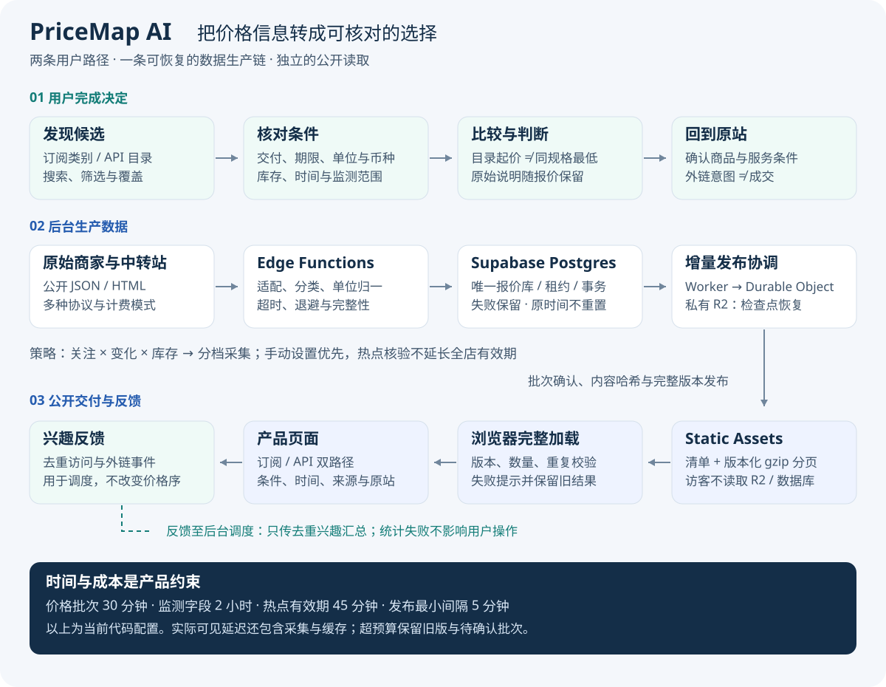

# PriceMap AI · AI 订阅与 API 比价工具

**为选购或续订 AI 服务的个人用户、选择模型 API 渠道的开发者，解决报价分散、规格难比、计费难懂的问题。**

我将原站报价、交付条件和更新时间汇总为两个查询入口：个人按产品与交付方式找订阅，开发者按模型与计费条件找 API。用户在站内缩小候选范围，再到对应原站核对和购买。

**已上线 · 订阅 / API 双路径 · 持续更新的原站数据 · 独立完成产品设计与工程交付**

[体验官网](https://pricemapai.com) · [3 分 11 秒实际演示](demo/assets/pricemapai-demo-2026-10-10.mp4) · [产品规划与 MVP](docs/product-design.md) · [Quick start](docs/quick-start.md)

官网首页实拍于 2026-10-17。下文操作画面来自 10 月 10 日历史演示；报价统计采用注明时点的公开快照。

## 产品定位：先让用户看懂候选，再完成选择

用户的任务从一个具体需求开始：给已有账号续费，或为正在开发的功能选择 API 渠道。直接逐家查找，需要反复搜索、抄价格、解释条件；仅把报价排在一起，又容易把不同商品当成同一种服务。

| 优先用户与场景 | 最容易卡住的决定 | 产品提供的价值 |
| --- | --- | --- |
| 个人已有 AI 账号，准备续订或更换渠道 | 便宜的报价到底是充值、成品号还是共享账号？期限和库存是否合适？ | 按产品与交付方式发现候选，详情保留原始说明、库存、时间与对应商品入口 |
| 开发者已确定目标模型，准备接入或比较 API 渠道 | 价格是现金还是余额额度？是否已含分组倍率？监测对应哪个模型？ | 将模型、分组、输入 / 输出单位、币种与监测范围放到同一次核对中 |

我选择做**采购前的信息比较工具**。相比静态价格表，重点是持续更新、条件解释和来源追查；相比直接交易平台，首版把精力放在报价与核对路径上。当前不承接支付、履约、模型调用或团队采购审批。[用户任务、替代方案与产品边界](docs/product-design.md)

## 首版 MVP：完成一次有依据的候选核对

**价值假设：集中候选并解释差异，能够减少查找与理解负担，让使用者更容易找到符合自己条件的服务。**

我把最小闭环定义为“找到目标 → 看懂条件 → 判断时效 → 核对原站”。它决定了首版范围，也决定了什么问题优先修复。

| 必须完成 | 产品设计 | 范围取舍 |
| --- | --- | --- |
| 找到相关候选 | 订阅与 API 分入口，按平台 / 产品 / 模型查找 | 共用数据基础，但不把两类需求塞进同一套排序 |
| 解释价格条件 | 订阅展示交付与期限；API 展示单位、币种、分组和计费模式 | 先保留原始条件，复杂阶梯价格不强行压成单一数字 |
| 判断能否继续使用 | 展示库存、采集时间、过期与失败状态 | 缺失信息保持未知，已有结果不会因局部失败被清空 |
| 到达正确原站 | 对应商品或报价入口，保留源站说明 | 不要求用户注册后才看报价，也不接管支付与售后 |

首个价值时刻是使用者能说明“这个候选为什么符合我的条件”，并找到对应原站。外链点击用于观察核对意图，任务观察再确认理解是否正确。[MVP 验收与需求优先级](docs/product-design.md#需求池与当前顺序)

## 核心体验：两类任务，各自完成闭环

| 订阅续费：从目标产品找到合适交付 | API 选型：从目标模型理解计费条件 |
| --- | --- |
|  |  |
| 选择产品与交付方式 → 查看商品说明、期限和库存 → 比较候选 → 原站确认 | 选择平台 / 模型 → 查看站点与分组 → 核对单位、币种和监测对象 → 原站试用前确认 |

已有录屏展示了目录、详情与商品原站跳转。购买路径曾出现“价格能抓到、按钮却到不了对应商品”的问题，因此我把原站商品身份纳入交付验收；修复覆盖 27 家店铺的 420 条 Kami 商品链接，而不只修改新采集逻辑。[完整操作旅程](demo/README.md) · [购买路径修复](src/pricemapai-web-production/docs/purchase-link-audit-2026-10-10.md)

## 产品演进：从查询可用，到持续运营

| 阶段 | 用户 / 运营问题 | 已完成的判断与交付 |
| --- | --- | --- |
| **建立查询价值** · 10 月 9 日 | 用户要在分散站点之间找候选、解释价格 | 上线订阅与 API 两条路径，接入原站数据，建立查询、详情与原站核对闭环 |
| **修复决定性阻力** · 10 月 10–11 日 | 交付类别、SKU 库存、跳转和输入细节会让任务中断 | 修正额度分类、购买路由、库存和中文输入；将对应商品与已有报价一并更新 |
| **让数据持续有用** · 10 月 10 日起 | 统一采集频率不能兼顾热点、变化与长期缺货 | 按关注、价格 / 库存变化调档；独立核验热点，保留手动控制和失败恢复 |
| **让投入支持扩展** · 10 月 12 日 | 全量同步和高频监测变化抬高更新开销 | 稳定 ID 增量发布、价格 / 监测分频、日预算与断点恢复；访客走静态读取 |

我将需求优先级放在**错误决策 → 任务阻断 → 持续可用 → 覆盖扩展**。新增来源能带来更多候选，但规格不清或链接不对时，先增加数量并不能改善选择质量。[完整需求池与阶段路线](docs/product-design.md)

## 技术架构：让比较质量与运行成本支撑产品体验

前端采用 React / Vite 与 Cloudflare 静态资产；Supabase 承担采集和唯一报价数据库；独立同步 Worker、Durable Object 与私有 R2 处理增量发布和恢复。访客读取版本化静态 JSON，页面访问与后台采集分开扩展。

| 关键技术判断 | 产品收益 | 需要承担的代价 |
| --- | --- | --- |
| **金额与规格使用确定性归一**：保留原名、比较键、单位、币种及倍率是否已应用 | 规则可追查，避免充值额度被当现金、倍率重复计算 | 规格不完整时自动可比覆盖受限，需要标注与补全 |
| **完整版本才交付**：分页校验、幂等批次、租约与事务 | 缺页、混版或采集失败不会覆盖已有可用结果 | 用户可见时间包含采集、发布与缓存，必须保留时效提示 |
| **按任务价值分配更新预算**：关注、变化、缺货分档与热点核验 | 将采集投入优先用于有需求、值得更新的信息 | 需要同时检查冷门来源覆盖和热点偏置 |
| **静态读取与增量发布**：公开查询不逐次访问数据库 | 用户访问增长与数据库查询压力解耦 | 引入发布链路与版本恢复，预算耗尽时需要接受数据变旧 |

### AI 服务比较，不能只有一个最低数字

API 的综合系数不足以代表用户的实际成本。同一模型还涉及输入 / 输出比例、分组倍率、充值额度、缓存和阶梯条件；商家公开可用率也需要结合探测对象与时间理解。因此我优先把计费语义和监测范围做清楚，再考虑工作负载成本计算。

当前线上分类、换算和调度使用确定性规则。未来如引入 LLM，首先用于提取非标准标题的规格候选，输出原文依据，再由字段、单位和金额校验把关；只有相对现有规则提高覆盖且没有增加关键错配，才进入发布链路。[换算示例、技术细节与资源预算](docs/technical-design.md)

## 已有结果，以及它们如何影响下一步

2026-10-17 13:47（北京时间）归档的公开版本包含 **4,822 条订阅报价、360 个商家标识、27 家 API 中转站和 3,319 条 API 报价**。这些说明产品已有数据供给与交付能力；用户价值还要看候选是否可理解、可核对、值得再次使用。

| 已有结果 | 产品判断 |
| --- | --- |
| 采样时 2,873 条订阅报价同时有效且有货 | 发现候选已有基础，继续观察真实采集年龄与任务相关覆盖 |
| 严格资格筛选仅通过 6 条报价，未形成多商家可比组；目录起价使用更宽规则 | 下一版优先统一“类别起价 / 同规格最低”的表达，再改善规格完整性 |
| 公开快照的 19 页压缩后约 0.74 MB，缺页 / 混版 / 重复故障均被拒绝 | 交付链路可离线复验，后续以真实延迟和成本衡量持续运行 |

我把**完成一次知情核对**作为价值目标：行为上观察相关详情与原站跳转，任务研究中确认条件理解、候选正确性和核对时间；重复使用则看下一次有选购需求时是否回来。当前已接入事件，尚无可核验的用户留存或成交统计。[真实快照与质量评估](evaluation/README.md) · [价值指标与实验](docs/metrics-and-experiments.md)

## 下一阶段：先证明选择质量，再扩大产品价值

1. **质量收敛**：统一价格标签，按高需求类别建立真实规格标注集，持续检查原站商品对应关系。
2. **任务验证**：比较逐家查找与聚合查询，观察订阅续费、API 选型的理解错误、完成情况和核对耗时；按需求周期观察回访。
3. **价值扩展**：验证重复需求后，再考虑工作负载成本计算、变价提醒与渠道合作。商业合作需要明确标识，自然价格排序独立于收益关系。

[产品定位、MVP 与需求池](docs/product-design.md) · [指标与实验方案](docs/metrics-and-experiments.md) · [真实演示](demo/README.md) · [Quick start](docs/quick-start.md) · [完整源码](src/pricemapai-web-production/)
