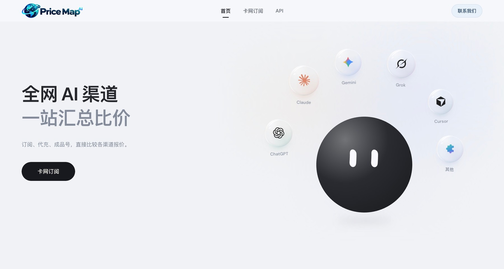
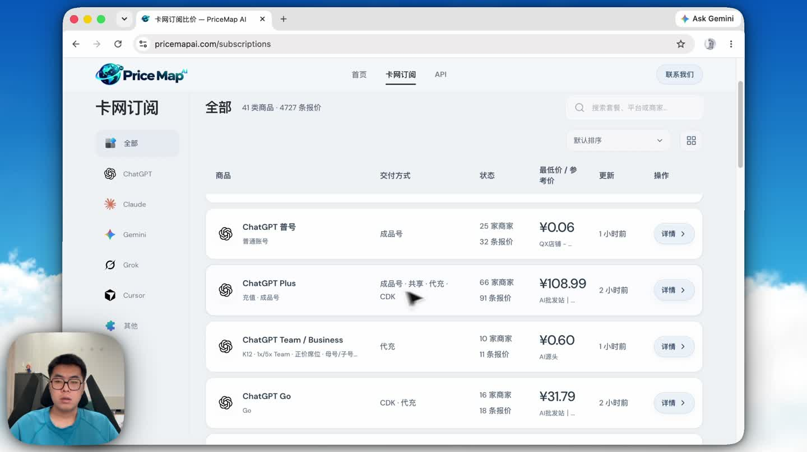
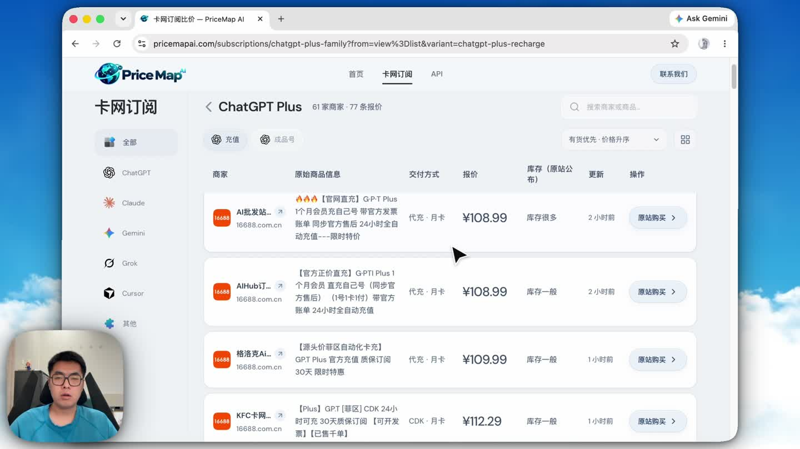
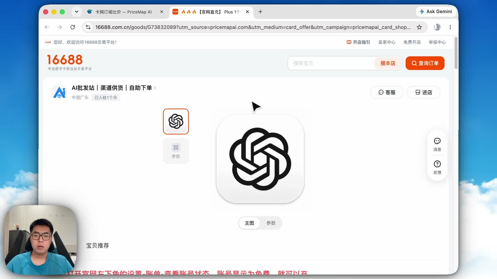
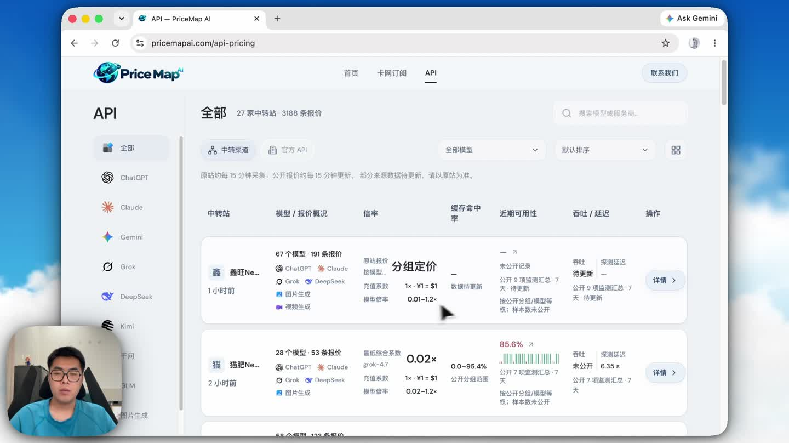
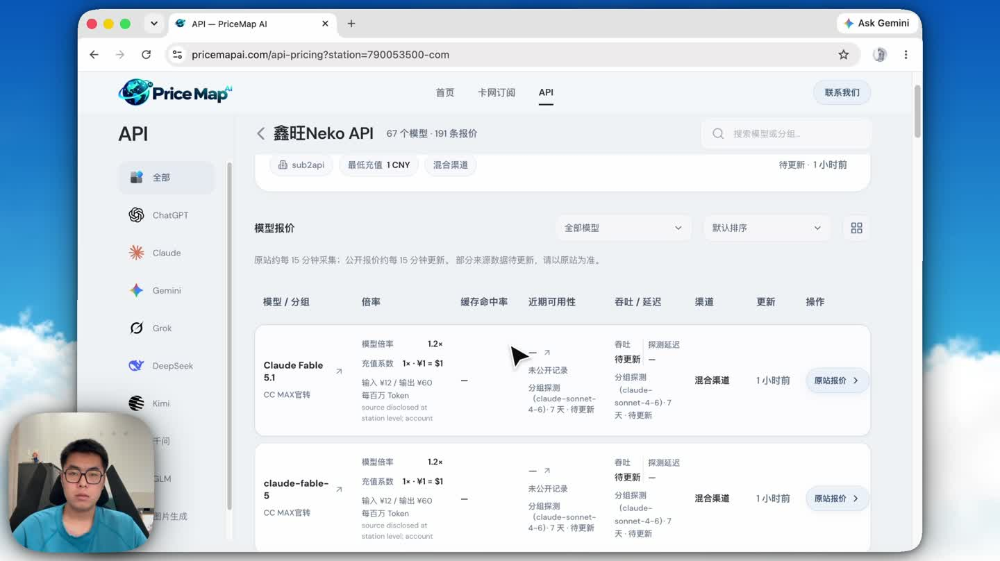

# 两条真实用户旅程

[返回项目](../README.md) · [打开正式产品](https://pricemapai.com) · [观看完整宣传演示 · 3 分 11 秒](assets/pricemapai-demo-2026-10-10.mp4)

## 官网入口

2026-10-17 在 Chrome 访问正式官网截取。首页将订阅与 API 分开，分别承接个人选购和开发者查询任务；截图只裁去浏览器工具栏与首屏之外区域，页面内容未改绘。

以下画面截自本地原始操作录屏，配合完整宣传视频展示产品怎样使用。画面中的价格和商家状态属于 2026-10-10 的历史展示，不作为当前推荐；数字口径采用项目首页注明日期的公开快照。

## 为已有账号找到续订候选

**进入任务：**以已有 ChatGPT 账号续订为例，希望找到合适的充值方式。目录先按产品族与交付方式缩小候选，避免直接比较名称相似的成品号、共享号和充值。

**核对条件：**进入详情，结合原始商品名称、期限、库存、更新时间与价格理解差异。类别起价用于发现候选，当前严格比较仍受规格完整性限制；不能仅凭最小数字完成选择。

**到达原站：**点击购买入口，进入对应商家商品页，再次确认规格、价格和交付条件。聚合产品的闭环到达“可核对的候选”，没有代用户下单；这也是后来修复购买路由时采用的验收终点。

## 为开发任务查找 API 渠道

**进入任务：**先选择平台 / 模型类别，查看站点与模型覆盖。目录将价格信息和商家公开监测放在同一入口，但保持其语义独立。

**核对计费：**进入站点详情，确认具体模型、分组、输入 / 输出单价、币种或余额单位，并查看监测对象和更新时间。未知数据保留未知；某个分组的可用率不能直接证明所有模型都真实、稳定或质量相同。

**下一步动作：**去原站确认充值与服务条款，根据实际工作负载试用。当前产品支持候选发现和成本解释；负载总价计算、独立探测和模型质量基准未纳入当前交付。

## 如何读这份演示

宣传视频展示完整讲解与实际操作；本页按用户决定重新组织原始录屏画面，不是重新制作的产品界面。原片未更改播放速度，压缩至 1280 像素宽 便于在仓库查看。[媒体来源与截帧时点](media-manifest.json)

[用户与 MVP](../docs/product-design.md) · [报价如何归一](../docs/technical-design.md) · [真实数据质量](../evaluation/README.md)
